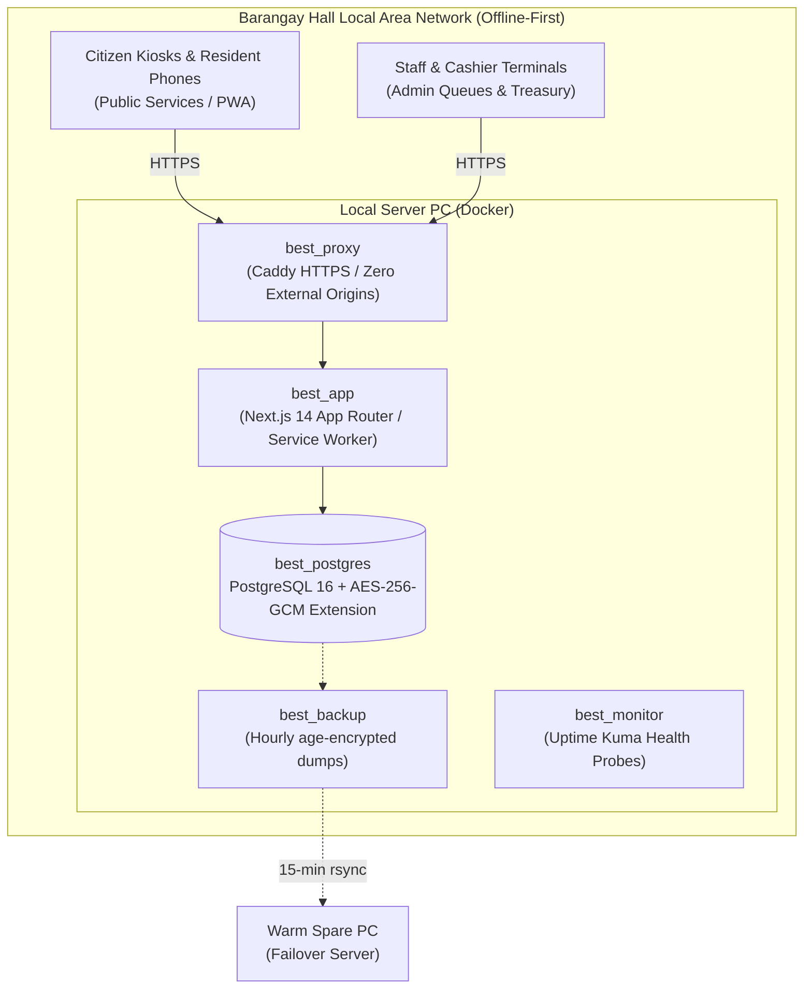

# Barangay E-Services System Terminal [BEST]
## Comprehensive System Operations & User Manual

> **Republic of the Philippines** • **Compliance**: Local Government Code (R.A. 7160) & Data Privacy Act (R.A. 10173)  
> **Architecture**: Offline-First LAN Operation • V5 Field-Level Encryption at Rest (AES-256-GCM)  
> **Development Team**: Cadavid, Genella, Gutib M., Gutib J., Saldua

---

## 1. System Overview & Architecture

The **Barangay E-Services System Terminal (BEST)** is a secure, offline-first municipal service delivery system designed for barangay hall networks. It enables seamless digital services—including document requests, anonymous blotter filing, community announcements, and treasury management—even when completely disconnected from the public internet.



### Key Security Invariants
1. **Zero External Origins (OFFLINE-01)**: The system contains no CDNs, external Google Fonts, or cloud analytics. All fonts and assets are 100% self-hosted.
2. **Field-Level Encryption at Rest (ENC-01)**: Sensitive fields (blotter narratives, exact incident locations, document purposes, and contact numbers) are encrypted in PostgreSQL using **AES-256-GCM** with a server-managed key (`FIELD_ENC_KEY`).
3. **Anonymous Blotter Protection (ZK-LOG-01)**: Complainants file reports without IP tracking, cookies, or identity collection. Spam prevention uses client-side Proof-of-Work (PoW).
4. **Server-Enforced 15-Minute Session Expiry (NFR-06)**: Both staff and resident sessions expire after 15 minutes of inactivity on the server.
5. **Print Fidelity (NFR-05)**: Certificate printouts are 100% solid Black-and-White A4/Letter with zero glassmorphism, styled for legal standard forms.

---

## 2. Public Citizen Services Portal

Citizens connect via the hall's Wi-Fi network or kiosk terminal at `http://localhost:3000` (or `https://best.lan`).

### 2.1 Document Request Filing (Clearance & Indigency)
Residents can request barangay certifications digitally:
1. Navigate to **Services $\rightarrow$ Request Document** (`/services/request`).
2. Sign in with your **Resident Number** (`RES-YYYY-XXXX`) and password, or activate a new account with a one-time slip.
3. Choose the document type:
   - **Barangay Clearance**: Statutory fee of ₱50.00 (requires Community Tax Certificate / Cedula).
   - **Certificate of Indigency**: **₱0.00 (Free of charge)** pursuant to R.A. 11261 (First Time Jobseekers Act) / Social Welfare Policy.
4. Input the intended purpose. The purpose is encrypted upon submission.
5. Receive an 11-character **Tracking Code** (e.g., `CLR-2026-XXXXXXXX` or `IND-2026-XXXXXXXX`) with an HMAC-signed verification hash.

### 2.2 Public Document Tracking
Citizens can check real-time readiness at `/track` without exposing private personal data:
- Input the tracking code.
- **Privacy Masking**: Citizen names are strictly masked to `J*** D**` (NFR-01).
- Advisories indicate if payment is required or if the document is **Ready for Pickup** at the Barangay Hall.

### 2.3 Anonymous Incident Blotter Filing
Citizens can safely report community disputes, noise disturbances, or security concerns:
1. Navigate to `/blotter`.
2. Select incident category and purok/zone.
3. Enter the incident narrative. The system locally scrubs identifying names, email addresses, and phone numbers.
4. The browser automatically solves a lightweight **SHA-256 Proof-of-Work challenge** (`/api/blotter/challenge`) to verify human interaction without capturing IP addresses.
5. Save the issued **Blotter Tracking Code** (`BLT-XXXX-XX`) to track tanod action status privately at `/blotter/track`.

### 2.4 Kaagapay Civic AI Assistant
Residents can query barangay ordinances, procedures, and office hours at `/services/kaagapay`.
- Operates in **Tagalog (TL)**, **Cebuano (CEB)**, and **English (EN)**.
- Operates locally via deterministic local knowledge bases without sending data to external APIs.

---

## 3. Staff & Administrative Management Portal

Authorized personnel access the management portal at **`/admin/login`**.

### 3.1 Role-Based Access Control (RBAC) Matrix

| Portal Module | Administrative Staff | Barangay Treasurer | Local Official | IT Administrator |
| :--- | :---: | :---: | :---: | :---: |
| **Review & Approve Documents** | ✅ | ❌ | ❌ | ✅ |
| **Print Legal QR Certificates** | ✅ | ❌ | ❌ | ✅ |
| **Inspect Decrypted Blotter** | ✅ | ❌ | ❌ | ✅ |
| **Issue Official Receipts (OR)** | ❌ | ✅ | ❌ | ✅ |
| **Assess Business Clearance** | ❌ | ✅ | ❌ | ✅ |
| **Publish Announcements** | ✅ | ❌ | ✅ | ✅ |
| **Manage Officials Directory** | ❌ | ❌ | ✅ | ✅ |
| **Deep Health & Audit Logs** | ❌ | ❌ | ❌ | ✅ |

### 3.2 Staff Workflows

#### A. Document Verification Queue (`/admin/documents`)
- **Review**: Open incoming requests to inspect the decrypted purpose and CTC number. Each read event writes an `AuditLog` entry.
- **Status Progression**:
  - `SUBMITTED` $\rightarrow$ `UNDER_REVIEW`: Staff begins investigation.
  - `UNDER_REVIEW` $\rightarrow$ `PAYMENT_PENDING`: Clearance requests awaiting cashier payment.
  - `UNDER_REVIEW` $\rightarrow$ `READY_FOR_PICKUP`: Approved indigency certificates (Free) or cleared payments.
  - `READY_FOR_PICKUP` $\rightarrow$ `RELEASED`: Document physically handed to applicant.
- **Assisted Walk-In Intake**: Desk staff can file requests for senior citizens or residents without smartphones via the *Assisted Walk-In Intake* modal.

#### B. Anonymous Blotter Queue (`/admin/blotter`)
- Inspect encrypted citizen reports. Clicking **Inspect & Update** decrypts the narrative server-side with audit logging.
- Dispatch barangay tanod units and post **Public Notes** (visible on citizen tracking) and **Internal Notes** (confidential to staff).
- Update status: `FILED` $\rightarrow$ `UNDER_REVIEW` $\rightarrow$ `ACTION_TAKEN` $\rightarrow$ `CLOSED`.

#### C. Resident Directory & Activation Slips (`/admin/residents`)
- Search master residents list by Purok or Resident ID.
- **Issue Activation Slip**: Generates a one-time, 10-character Crockford base32 activation code valid for 7 days. Print or hand the slip to the resident to activate their online account.
- **Assisted Resident Registration**: Register new verified barangay residents presenting valid government IDs.

#### D. Treasury & Cashier (`/admin/treasury`)
- Collect ₱50 document clearance fees and business permit fees.
- Issues unique, sequential Official Receipts (`OR-2026-XXXX`).
- Settling a payment automatically moves the document status from `PAYMENT_PENDING` to `READY_FOR_PICKUP`.

#### E. Community Broadcast Publisher (`/admin/broadcasts`)
- Create announcements categorized under *Urgent*, *Ayuda*, *Health*, *Veterinary*, or *Scholarship*.
- **AI Simplify**: Uses local NLP to generate a concise summary for citizen kiosks and an audio script tailored for mobile barangay patrol speakers.

---

## 4. Print Fidelity Engine (NFR-05)

Certificates are printed directly from `/admin/documents/print/[id]`.

### Certificate Specifications
- **Format**: Standard A4 or US Letter Portrait.
- **Styling**: Pure high-contrast black-and-white. Zero background fills, zero glassmorphism, and zero screen navigation elements.
- **QR Code Verification**: Renders a 300 DPI vector QR code containing the tracking code and HMAC signature. Anyone scanning the QR code is directed to `/track?code=...` to verify authenticity against the database.
- **Official Components**:
  1. Republic of the Philippines barangay seal header.
  2. Legal text certification of good moral character / indigency status.
  3. Official CTC Number and Cashier OR Number.
  4. Right thumbmark placeholder box and applicant signature line.
  5. Punong Barangay formal attestation block.

---

## 5. System Administration & Disaster Recovery

### 5.1 Starting and Stopping the Server

```bash
# Start PostgreSQL Database container
docker compose up -d best_postgres

# Start Application Server
npm run start

# Launch full production stack with Caddy HTTPS proxy & reliability overlay:
docker compose -f docker-compose.yml -f docker-compose.reliability.yml up -d
```

### 5.2 Key Management & Environment Configuration (`.env`)
- `FIELD_ENC_KEY`: 32 random bytes in base64. Generated via `npm run keys:generate`. Stored exclusively in `.env` with file permissions `600`. Never committed to git.
- `QR_HMAC_SECRET`: 256-bit secret for signing verification QR codes.
- `POSTGRES_PASSWORD`: Database master password.
- `SESSION_SECRET`: Key for encrypting JWE session cookies.

### 5.3 Automated Backups & Warm Spare Failover
- **Hourly Encrypted Backups**: Handled by `best_backup` container running `ops/backup/backup.sh`. Backups are encrypted using `age -r "$BACKUP_AGE_PUBKEY"` and written to `/mnt/backupdisk/dumps/`.
- **Retention**: Prunes automatically to retain 48 hourly, 14 daily, 8 weekly, and 12 monthly backups.
- **Warm Spare Synchronization**: `sync-spare.sh` uses `rsync` over LAN every 15 minutes to synchronize dumps to a backup PC (`$SPARE_HOST`).
- **Promoting the Spare Server**: If the primary hardware suffers catastrophic failure:
  ```bash
  # On the Warm Spare PC:
  sh ops/scripts/promote-spare.sh
  ```
  Repoint the router DNS entry for `best.lan` to the spare PC's IP address. Recovery completes within 60 minutes.

### 5.4 Verification & Quality Gates
Before deploying updates, run the automated verification suite:
```bash
# 1. Statutory Policy Gate
npm run check:policy

# 2. Production Credential Tripwire
npm run check:demo-creds

# 3. Next.js Production Build
npm run build

# 4. Playwright End-to-End Suite
npx playwright test
```

---
*Barangay E-Services System Terminal [BEST] • Operational Release 2026*
