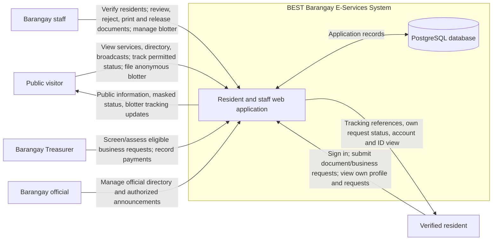
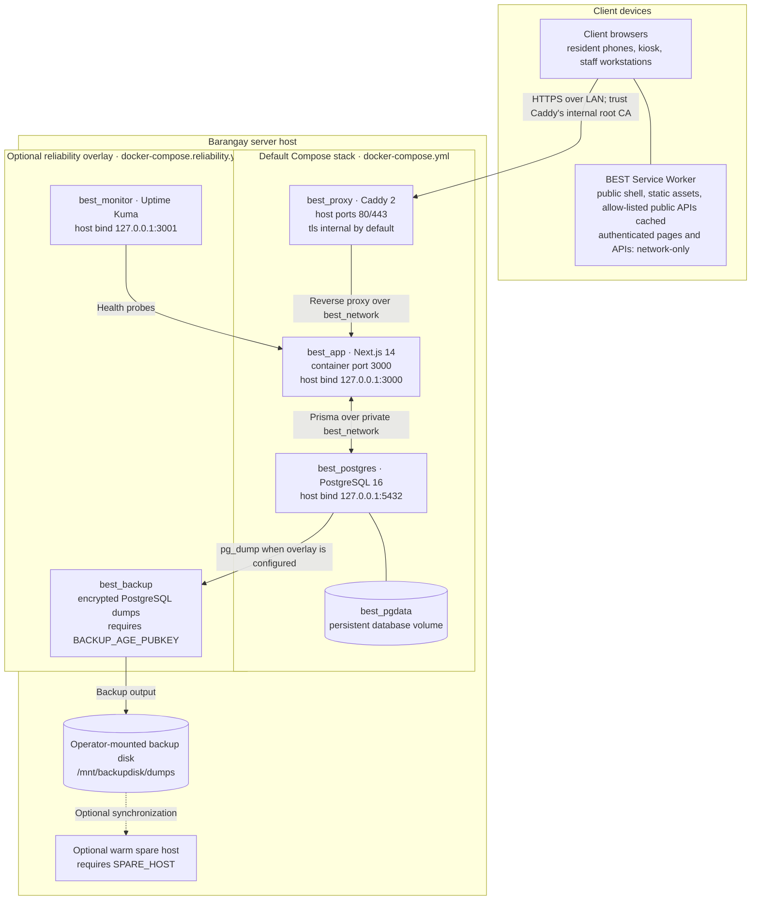
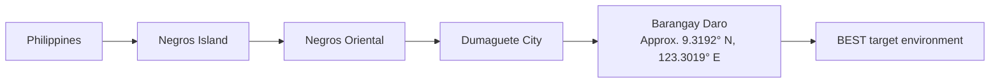

# BEST System: Research Diagrams and Target Environment

**System:** Barangay E-Services System Terminal (BEST)
**Target environment:** Barangay Daro, Dumaguete City, Negros Oriental, Philippines
**Prepared:** 24 November 2026
**Purpose:** Research-paper-ready system context, deployment view, and study-site locator

> The diagrams below describe the repository's intended LAN deployment and current application modules. They are editable Mermaid diagrams. The target-site map is an online geographic locator centered approximately within Barangay Daro, not a cadastral, engineering, or official barangay-boundary map.

## 1. Context Diagram

BEST is the central system in this context diagram. Residents and public visitors use its public-facing services. Verified residents can submit requests and view statuses linked to their own accounts. Barangay staff use role-controlled tools for authorized workflows. The system uses a local PostgreSQL database. The diagram shows BEST's boundary and users, not its internal algorithms or software modules.

### Context diagram notes

- Blotter reports can be submitted without a resident account and are not linked to a resident record. Authorized staff access to report details is protected.
- Public document tracking returns the request status and a masked resident name; it does not provide an anonymous resident record.
- Resident-linked requests use the verified session. The system does not trust a resident ID supplied by the browser.
- This is a logical context view. It omits individual browser routes and internal software components.

## 2. Deployment Diagram

The production deployment is designed for a barangay-controlled server and local network. Residents and staff use web browsers. Caddy is the HTTPS entry point. The Next.js application communicates with PostgreSQL on the Docker network. The reliability overlay can add backup and monitoring containers when configured.

### Deployment diagram notes

- In the repository's default Compose configuration, PostgreSQL and the application ports are bound to loopback on the host. LAN clients should use Caddy, not connect directly to PostgreSQL or the app's internal development endpoint.
- Caddy's default configuration uses an internal TLS certificate authority. Client devices must trust the appropriate certificate to avoid browser certificate warnings.
- best_backup, best_monitor, a separate backup disk, and a warm spare depend on the reliability overlay and operator-provided configuration. The diagram does not imply those services are already installed at the target site.
- The PWA caches selected public shell routes, immutable static assets, and allow-listed public APIs. Admin and resident-authenticated pages, along with authenticated API responses, are network-only and excluded from the Service Worker's cache.

## 3. Map of the Target Environment

### 3.1 Geographic locator

The target environment is Barangay Daro within Dumaguete City, Negros Oriental, Philippines. The Philippine Statistics Authority's Philippine Standard Geographic Code listing identifies Daro as an urban barangay of Dumaguete City. The coordinates below are an approximate point within Daro reported by PhilAtlas; they are not coordinates surveyed at the barangay hall.

**Open the locator map:** [Barangay Daro, Dumaguete City in OpenStreetMap](https://www.openstreetmap.org/?mlat=9.3192&mlon=123.3019#map=15/9.3192/123.3019)

| Locator level | Place |
|---|---|
| Country | Philippines |
| Island | Negros |
| Province | Negros Oriental |
| City | Dumaguete City |
| Barangay | Daro |
| Approximate barangay locator point | 9.3192° N, 123.3019° E |
| Map scale/view | OpenStreetMap zoom level 15; map scale varies by display |

### 3.2 Site locator schematic

This hierarchy is included for a printed research document when an online map cannot be displayed. It is a locator schematic, not a drawn barangay boundary.

### 3.3 Map limitations and preparation for final submission

- The point above represents an approximate location inside Barangay Daro, not the exact BEST server, barangay office entrance, or research participant location.
- This file does not redraw barangay boundaries. For a formal printed location map, obtain the current official barangay/city boundary layer or approved map from the City of Dumaguete or the relevant national mapping office, then add a clearly labeled site marker and scale bar.
- If the study specifically concerns the barangay hall, confirm its current address and exact coordinates with barangay staff before moving the map pin. A city government post lists Daro Barangay Hall as an evacuation-center location, but that post does not provide a precise coordinate.
- OpenStreetMap data is © OpenStreetMap contributors and licensed under the Open Database License. Keep attribution visible if exporting or reproducing its map.

## 4. References for the target environment

- Philippine Statistics Authority, [City of Dumaguete — PSGC barangay listing](https://psa.gov.ph/classification/psgc/barangays/1804610000) — official city/barangay classification, Daro PSGC code, and urban classification.
- OpenStreetMap, [Daro locator map](https://www.openstreetmap.org/?mlat=9.3192&mlon=123.3019#map=15/9.3192/123.3019) — interactive locator centered on the approximate Daro coordinate.
- PhilAtlas, [Daro, City of Dumaguete](https://www.philatlas.com/visayas/r07/negros-oriental/dumaguete/daro.html) — approximate coordinate and adjacent-barangay information; secondary reference.
- City Government of Dumaguete, [Know Your Nearest Evacuation Centers](https://dumaguetecity.gov.ph/2021/12/21/know-your-nearest-evacuation-centers/) — identifies Daro Barangay Hall as a listed evacuation-center site.
- BEST repository, [system documentation](SYSTEM-DOCUMENTATION.md) and [implementation plan](implementation-plan.md) — application purpose, modules, architecture, and deployment design.

---

**Use in a research paper:** cite the map data source and retrieval date, add a figure number and caption, and obtain adviser or LGU approval if the submission requires an official study-site boundary map. The diagrams represent the software system; they are not evidence that the application has been operationally deployed at the barangay hall.
