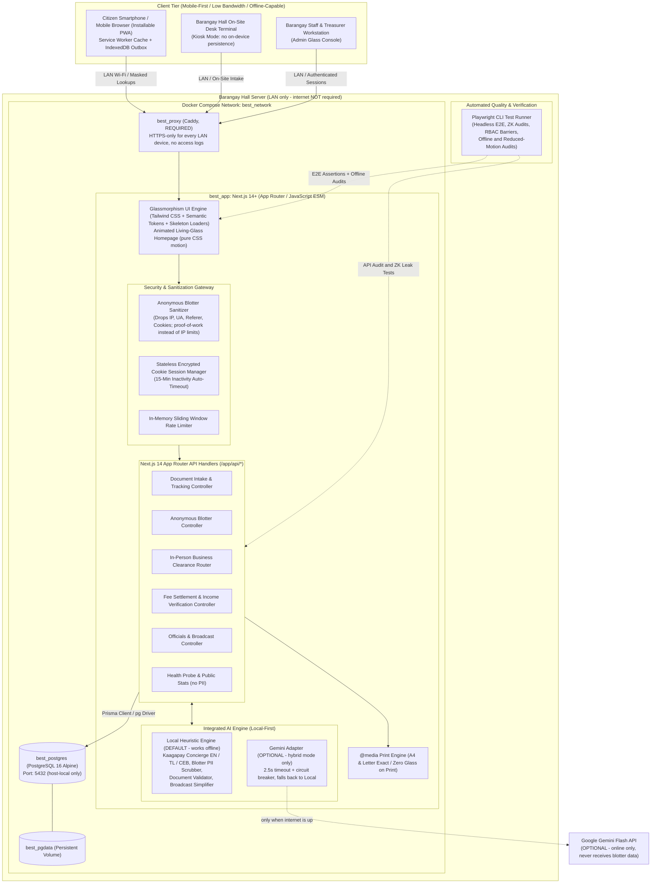
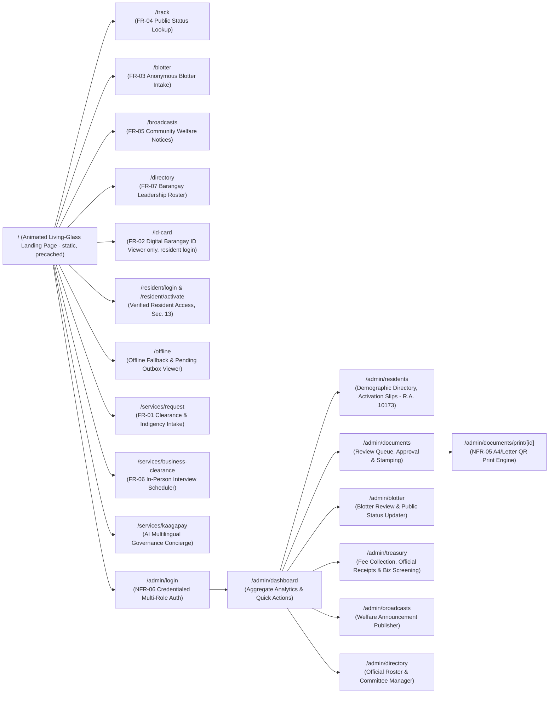
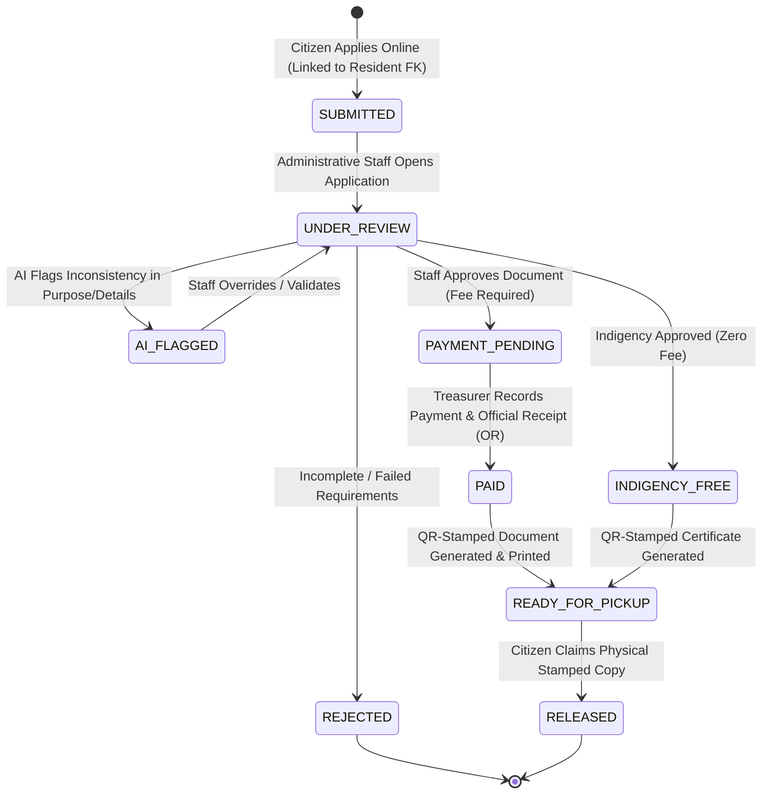
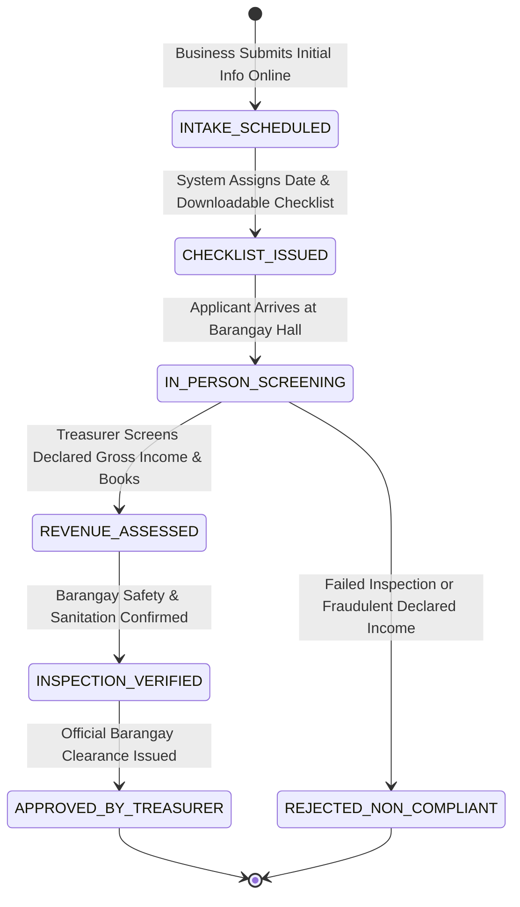
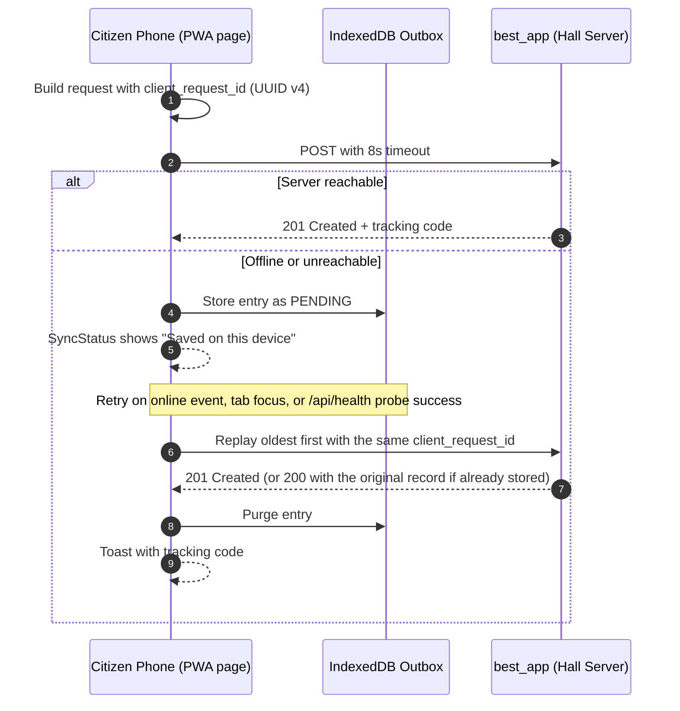
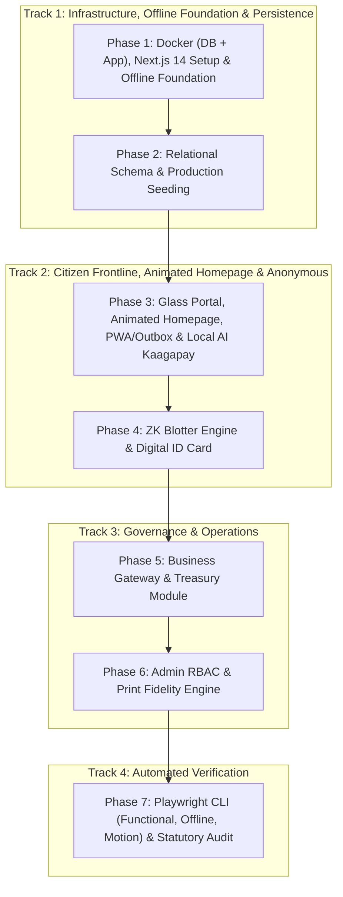
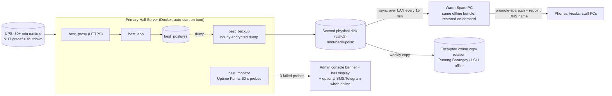

---
# ==============================================================================
# UNIVERSAL AI AGENT & CLI EXECUTION MANIFEST
# ==============================================================================
# Any autonomous AI agent (Cursor, Claude Code, Windsurf, Aider, Antigravity)
# or CLI test runner must parse and follow this manifest strictly.
# ==============================================================================
project:
  name: "Barangay E-Services System Terminal [BEST]"
  statutory_compliance:
    - "Republic Act 7160 (Local Government Code of 1991)"
    - "Republic Act 10173 (Data Privacy Act of 2012)"
  team: ["Cadavid", "Genella", "Gutib M.", "Gutib J.", "Saldua"]
  runtime: "Node.js >= 18.17.0 (container image pins Node 20 LTS Alpine)"
  language: "JavaScript (ESM / React JSX) - STRICT: NO TYPESCRIPT"
  framework: "Next.js 14.2.x (App Router), patched release >= 14.2.25"
  database: "PostgreSQL 16 (Docker Compose)"
  orm: "Prisma 5.x (JavaScript Client)"
  design_system: "Glassmorphism with Tailwind CSS & Semantic Tokens (self-hosted fonts and icons, zero CDN)"
  animation: "Pure CSS keyframes + IntersectionObserver (no animation library); prefers-reduced-motion honored"
  offline: "Offline-first PWA: hand-written Service Worker + IndexedDB outbox; full stack runs on a LAN-only hall server"
  testing: "Playwright CLI (Headless Chromium: Desktop, Mobile, Reduced-Motion; offline and zero-external-origin audits)"
  ai_engine: "Local deterministic heuristic engine (default, works offline) + optional Gemini Flash enhancement (online only, never for blotter or any encrypted sensitive field)"
  encryption: "HTTPS-only; server-side field encryption (AES-256-GCM) for sensitive citizen and staff fields; LUKS and age-encrypted backups at rest"
  reliability: "99.5% monthly availability target: UPS, host watchdog, hourly encrypted backups to a second disk, warm spare, Uptime Kuma monitor (Sec. 11)"

agent_policy:
  forbidden_skills:
    - "superpowers"   # The Superpowers skill/plugin, its slash commands and bundled workflows must NOT be installed, loaded or invoked.
  allowed_skills:
    - "taste-skill"
    - "impeccable-design"
    - "awesome-design"
    - "ui-ux-pro-max"
  enforcement: "AGENTS.md at the repo root repeats this policy; only skills vendored in .agents/skills/ may be used; `npm run check:policy` fails if Superpowers appears anywhere in the repo. Follow the phases in Section 9 of this plan directly."

invariants:
  - "NFR-02: Anonymous Blotter - Never store IP, User-Agent, cookies, or complainant resident_id."
  - "FR-06: Business Clearance - NEVER allow automated online approval; strictly require in-person Treasurer screening (barangay anti-fraud policy; R.A. 7160 Sec. 152(c) only authorizes the clearance and a reasonable fee and sets a 7-working-day action period)."
  - "NFR-01: Public Tracking - NEVER expose unmasked resident PII in public lookups (mask to J*** D**)."
  - "NFR-05: Print Fidelity - Completely decouple Glassmorphism on @media print (pure B&W A4/Letter)."
  - "NFR-06: Security - Enforce a 15-minute inactivity session timeout on the SERVER for staff and resident sessions; the client countdown is only a courtesy."
  - "OFFLINE-01: Offline-First - Every citizen flow and the whole admin console must work with NO internet (LAN only). No runtime request may leave the hall network except the optional, non-blocking Gemini call. No CDN, Google Fonts, analytics or remote images."
  - "OFFLINE-02: Offline Privacy - Never cache admin or authenticated responses, or resident PII, in Service Worker caches. On-device persistence is limited to what the citizen typed, is purged on successful sync, and is disabled in kiosk mode."
  - "OFFLINE-03: Local AI Privacy - Blotter narratives are scrubbed by the local regex engine only and are NEVER sent to any external AI/API."
  - "MOTION-01: Motion Safety - The animated homepage animates transform/opacity only, honors prefers-reduced-motion, stays fully readable with JavaScript disabled, and is disabled in @media print."
  - "AGENT-01: The Superpowers skill (or any plugin, command or workflow carrying that name) MUST NOT be installed, loaded or invoked for this project."
  - "ENC-01: Sensitive fields (blotter narrative and exact location, document purpose and CTC number, business details, staff-entered resident PII) are encrypted by the server with AES-256-GCM before storage. The field key lives only in the server `.env`, never in git, logs or database dumps. No plain-HTTP listener may exist."
  - "ZK-LOG-01: No access logging, IP, User-Agent, Referer, cookie or X-Forwarded-For may reach or be recorded by the blotter path; spam control uses proof-of-work, not IP."
  - "AUTH-01: No resident-linked write without a verified resident session; request bodies never carry resident_id."
  - "SEED-01: Demo credentials and demo data MUST NOT exist in production; the app refuses to boot if they do."
  - "PERF-01: Lite tier is the baseline; blur and looping motion are Full-tier enhancements bound by the weight and speed budgets in Sec. 14."
  - "REL-01: Backups are hourly, encrypted, stored on a second disk, and restore-tested monthly (Sec. 11)."
  - "SCOPE-01: Katarungan Pambarangay / Lupon proceedings are out of scope for this release; no hearing, summons or escalation states exist."
---

# Implementation Plan: Barangay E-Services System Terminal [BEST]

**Version**: V5 (Encryption at Rest | Reliability Plan | ID View-Only | Resident Verification | Adaptive Glass Performance)  
**Statutory Compliance**: Republic Act 7160 (Local Government Code of 1991) & Republic Act 10173 (Data Privacy Act of 2012)  
**Project Team**: Cadavid, Genella, Gutib M., Gutib J., Saldua  
**Core Frameworks**: Graphify (Visual Models & Schemas) | Ponytail (Zero-Bloat Lean JS) | Caveman (High-Density Technical Specs) | Phased Execution Gates (plain, project-native phases - **the Superpowers skill is NOT used**)  
**Architecture & Tech Stack**: **Next.js 14+ (App Router, JavaScript / JSX)** + **Dockerized PostgreSQL 16 and App Container** + **Offline-First PWA (Service Worker + IndexedDB Outbox)** + **Playwright CLI (E2E Testing)**  
**Design Intelligence & Skills**: **taste-skill**, **impeccable-design**, **awesome-design** and **UI/UX PRO Max**, all vendored in `.agents/skills/` so they work offline. Magic MCP (`@21st-dev/magic`) is optional, dev-time and online-only.  
**Design System**: **Impeccable Glassmorphism** (Frosted Translucent Surfaces, Ambient Depth, High-Fidelity Responsive UI) + **Semantic Colors** + **Glassmorphic Skeleton Loaders** + **Animated "Living Glass" Homepage** + **Strict Print Engine Separation**

### V5 Change Log (what changed from V4)

| # | Request | What changed in V5 | Where to look |
| :-: | :--- | :--- | :--- |
| 1 | Replace browser encryption with server-side encryption | Sensitive fields are encrypted by the server with AES-256-GCM, using `FIELD_ENC_KEY` in `.env`. Removed the browser sealing, the RSA records key pair, the two key custodians, the USB key copies and the "Unlock Records" step. HTTPS stays mandatory. | Sec. 6, 7.8, 10, 12 |
| 2 | Replace "zero-knowledge" with "anonymous" | The server can read blotter narratives, so "zero-knowledge" was inaccurate. Rule IDs (such as ZK-LOG-01) and test file names are unchanged. | Throughout; Sec. 15 |
| 3 | Backup copies can use any removable storage | The offline backup rotation no longer requires USB. | Sec. 11 |
| 4 | Keep key copies apart from backups | The spare key copy is no longer kept with the offline backup. | Sec. 12.3 |
| 5 | Version | Edited plan renamed to V5. V4 is the original upload. | Header |

### V4 Change Log (what changed from V3)

| # | Request | What changed in V4 | Where to look |
| :-: | :--- | :--- | :--- |
| 1 | Add end-to-end encryption | HTTPS is now mandatory everywhere (the plain-HTTP citizen mode is removed, because browsers only expose WebCrypto on secure origins). Citizen-submitted sensitive fields are sealed in the browser (AES-256-GCM key wrapped with the barangay's RSA-OAEP-3072 public key) and stored only as ciphertext. Staff-entered PII gets field-level encryption, and disks/backups are encrypted at rest. | Sec. 12, 6.1, 6.2, 7.8 |
| 2 | Reliability plan for 99.5% uptime (NFR-03) | Measurable definition (3 h 36 min/month budget), UPS, auto-restart watchdog, hourly encrypted backups to a second disk, warm spare PC, monitoring, restore and failover drills, and acceptance tests. | Sec. 11 |
| 3 | Barangay ID follows the Activity 2 scope | The ID is a **digital front-and-back viewer only** (like the national ID in eGovPH), behind resident login. No print layouts, print pages or print permissions exist, and physical card printing stays out of scope. | Sec. 17, 1.2, 6.5 |
| 4 | No Katarungan Pambarangay / Lupon in this release | Removed Lupon hearings, conciliation summons and court escalation from the blotter lifecycle, enum, ERD, schema, routes and UI text. Blotter statuses are now `FILED`, `UNDER_REVIEW`, `ACTION_TAKEN`, `CLOSED`. | Sec. 1.3-C, 1.4, 6.3 |
| 5 | Zero-knowledge hardening | Proxy and server logging disabled for blotter routes, identifying headers stripped, proof-of-work replaces IP-based rate limiting, timestamps coarsened, plain-language "best-effort anonymity" statement. | Sec. 15 |
| 6 | Resident identity verification | Residents are verified once at the hall and receive a one-time activation slip. Document and business requests now require a verified resident session (no more public `resident_id` in the request body). Walk-in assisted intake added. | Sec. 13, 6.4, 6.5 |
| 7 | Keep glassmorphism + animated homepage, but usable on entry-level phones | Lite tier is the baseline, Full tier (blur, motion) is a progressive enhancement chosen by detection plus a frame-time probe, with a manual toggle, hard weight budgets and Playwright low-end tests. | Sec. 14, 3.2, 8 |
| - | Smaller fixes | Surname spelling corrected to **Cadavid**. Demo credentials can no longer exist in production (separate seeds, boot-time tripwire, bootstrap admin). Session timeout is now enforced on the server. The R.A. 7160 Sec. 152 wording is corrected: the in-person screening is a barangay policy, not a mandate of Sec. 152. Compose no longer falls back to a default database password. | Sec. 16, 10.2, 10.3 |

### V3 Change Log (what changed from V2)

| # | Request | What changed in V3 | Where to look |
| :-: | :--- | :--- | :--- |
| 1 | Do not use the Superpowers skill | Removed the Superpowers name and framework; the 7 phases are now plain project-native phases. Added a machine-readable ban (`agent_policy.forbidden_skills`), invariant `AGENT-01`, a root `AGENTS.md`, and `npm run check:policy`, which fails if Superpowers appears anywhere in the repo. | Manifest, Sec. 9, Sec. 10.3 |
| 2 | Usable offline | Whole stack (app + DB) runs LAN-only in Docker; local AI engine is the default (Gemini optional); self-hosted fonts/icons plus a CSP that blocks external origins; PWA with Service Worker and IndexedDB outbox; air-gapped install bundle; offline Playwright tests. | Sec. 1.1, 6.1-6.2, 7, 9 |
| 3 | Animated homepage | "Living Glass" landing page: ambient orbs, rotating Bisaya/Tagalog/English greeting, animated masked-ticket demo, count-up stats, animated request-journey path, broadcast ticker. Pure CSS + IntersectionObserver, reduced-motion safe, precached for offline. | Sec. 3.3, 8 |
| - | Other changes | Magic MCP made optional; fonts reduced to Plus Jakarta Sans + JetBrains Mono (self-hosted); Next.js pinned to a patched 14.2.25+; DB port bound to localhost; `client_request_id` added for safe offline replays; section numbering fixed; machine-specific `file:///c:/Users/Lloyd/...` skill links made relative. | Throughout |

---

## 1. Graphify: Architectural, Component, Pipeline & Relational Models

### 1.1 Multi-Layer System Topology & Container Network (Offline-First, LAN-Only Capable)


> V4: `best_proxy` is required and `best_app` listens on `127.0.0.1` only. There is no plain-HTTP mode, so passwords and form data are never readable on the Wi-Fi, and browsers allow the PWA and service worker only on secure origins (see Sec. 7.8 and Sec. 12).

### 1.2 Module Route Tree & Information Architecture


### 1.3 State Machine Automata

#### A. Document Request Lifecycle (FR-01, FR-04, NFR-05)


#### B. Mandatory In-Person Business Clearance Lifecycle (FR-06)


#### C. Anonymous Blotter Lifecycle (FR-03, NFR-02)

```mermaid
stateDiagram-v2
    [*] --> CLIENT_SCRUB: Citizen's browser removes names/phones locally (nothing sent yet)
    CLIENT_SCRUB --> SEND_HTTPS: Narrative + exact location/time sent over HTTPS
    SEND_HTTPS --> STRIP_NETWORK_HEADERS: Request via proxy (no IP, UA, Referer or cookie reaches the app)
    STRIP_NETWORK_HEADERS --> GENERATE_ALPHANUMERIC_KEY: 10-Char Tracking Code Assigned (e.g. BLT-7X9K-42)
    GENERATE_ALPHANUMERIC_KEY --> FILED: Encrypted by the server and saved, no client linkage
    FILED --> UNDER_REVIEW: Authorized desk officer opens the report (server decrypts; read is logged)
    UNDER_REVIEW --> ACTION_TAKEN: Action recorded as a public note on the tracking code
    ACTION_TAKEN --> CLOSED: Report closed
    UNDER_REVIEW --> CLOSED: No further action needed
    CLOSED --> [*]
```

> Scope note (SCOPE-01): Katarungan Pambarangay, Lupon hearings, summons and court certification are **not** part of BEST in this release.

### 1.4 Fully Relational Entity-Relationship Model (PostgreSQL)

```mermaid
erDiagram
    RESIDENT ||--|| BARANGAY_ID_CARD : "has 1-to-1"
    RESIDENT ||--o| RESIDENT_CREDENTIAL : "activated at the hall"
    RESIDENT ||--o{ DOCUMENT_REQUEST : "submits 1-to-many"
    RESIDENT ||--o{ BUSINESS_CLEARANCE : "owns 1-to-many"
    
    DOCUMENT_REQUEST ||--o| PAYMENT_RECORD : "settled by 1-to-1"
    DOCUMENT_REQUEST }o--o| SYSTEM_USER : "reviewed by"

    BUSINESS_CLEARANCE ||--o{ BUSINESS_CHECKLIST_ITEM : "requires 1-to-many"
    BUSINESS_CLEARANCE ||--o| PAYMENT_RECORD : "settled by 1-to-1"
    BUSINESS_CLEARANCE }o--o| SYSTEM_USER : "assessed by"
    BUSINESS_CHECKLIST_ITEM }o--o| SYSTEM_USER : "verified by"

    PAYMENT_RECORD }o--|| SYSTEM_USER : "collected by"

    BLOTTER_REPORT ||--o{ BLOTTER_UPDATE : "tracks 1-to-many"
    BLOTTER_REPORT }o--o| SYSTEM_USER : "assigned officer"
    BLOTTER_UPDATE }o--|| SYSTEM_USER : "recorded by"

    COMMUNITY_BROADCAST }o--|| SYSTEM_USER : "authored by"
    BARANGAY_OFFICIAL |o--o| SYSTEM_USER : "optional login"
    AUDIT_LOG }o--|| SYSTEM_USER : "performed by"

    RESIDENT {
        string id PK "RES-2026-XXXX"
        string first_name
        string last_name
        string middle_name
        string suffix
        date birth_date
        string gender
        string civil_status
        string blood_type
        string contact_number
        string email
        string purok
        string street_address
        string emergency_contact_name
        string emergency_contact_phone
        string photo_url
        boolean is_registered_voter
        int years_of_residency
        boolean is_verified
        timestamp created_at
        timestamp updated_at
    }

    RESIDENT_CREDENTIAL {
        string resident_id PK "FK -> RESIDENT.id (1-to-1)"
        string password_hash "bcrypt, null until activated"
        string activation_hash "one-time code hash"
        timestamp activation_expires
        timestamp activated_at
        string issued_by_id FK "-> SYSTEM_USER.id"
        int failed_attempts
        timestamp locked_until
        timestamp session_valid_after
    }

    BARANGAY_ID_CARD {
        string id PK "BID-2026-XXXX"
        string resident_id FK "UNIQUE -> RESIDENT.id"
        string card_number "UNIQUE"
        string barcode_data "UNIQUE Code128"
        date issued_date
        date valid_until
        string status "ACTIVE | EXPIRED | REVOKED"
        timestamp created_at
    }

    DOCUMENT_REQUEST {
        string tracking_code PK "CLR-2026-XXXXXXXX or IND-2026-XXXXXXXX"
        string resident_id FK "-> RESIDENT.id"
        string document_type "CLEARANCE | INDIGENCY"
        string purpose
        string ctc_number
        date ctc_issued_date
        string status "SUBMITTED | UNDER_REVIEW | PAYMENT_PENDING | READY_FOR_PICKUP | RELEASED | REJECTED"
        string rejection_reason
        decimal fee_amount
        string qr_hash "UNIQUE SHA-256 Digest"
        string client_request_id "Nullable UNIQUE - offline outbox idempotency"
        text ai_verification
        string reviewed_by_id FK "Nullable -> SYSTEM_USER.id"
        timestamp created_at
        timestamp updated_at
    }

    BUSINESS_CLEARANCE {
        string id PK "BIZ-2026-XXXX"
        string resident_id FK "-> RESIDENT.id (Owner)"
        string business_name
        string nature_of_business
        string business_address
        decimal declared_gross_income
        timestamp physical_appointment_date
        string status "INTAKE_SCHEDULED | IN_PERSON_SCREENING | TREASURER_ASSESSED | APPROVED | REJECTED"
        string assessed_by_id FK "Nullable -> SYSTEM_USER.id (Treasurer)"
        decimal assessed_fee
        text assessment_notes
        string client_request_id "Nullable UNIQUE - offline outbox idempotency"
        timestamp created_at
        timestamp updated_at
    }

    BUSINESS_CHECKLIST_ITEM {
        string id PK "CHK-2026-XXXX"
        string business_id FK "-> BUSINESS_CLEARANCE.id"
        string item_code "DTI_SEC | LEASE | FIRE | SANITARY | INSPECTION"
        string title
        boolean is_complied
        string verified_by_id FK "Nullable -> SYSTEM_USER.id"
        timestamp verified_at
        string remarks
    }

    PAYMENT_RECORD {
        string id PK "PAY-2026-XXXX"
        string document_request_id FK "Nullable UNIQUE -> DOCUMENT_REQUEST.tracking_code"
        string business_clearance_id FK "Nullable UNIQUE -> BUSINESS_CLEARANCE.id"
        decimal amount
        string receipt_or_no "UNIQUE Official Receipt"
        string payment_method "CASH | GCASH_MOCK | LANDBANK_MOCK"
        string collected_by_id FK "-> SYSTEM_USER.id"
        string remarks
        timestamp collected_at
    }

    BLOTTER_REPORT {
        string tracking_code PK "BLT-XXXX-XXXX"
        string incident_type "NOISE | PROPERTY_DAMAGE | DISPUTE | THEFT | GENERAL"
        string incident_zone "Coarse purok/zone only (plaintext)"
        date incident_date "Date only (plaintext)"
        text enc_payload "Server-encrypted (AES-256-GCM): narrative + exact location/time"
        string urgency_level "LOW | MEDIUM | HIGH | CRITICAL"
        string status "FILED | UNDER_REVIEW | ACTION_TAKEN | CLOSED"
        string assigned_officer_id FK "Nullable -> SYSTEM_USER.id"
        timestamp created_at
        timestamp updated_at
    }

    BLOTTER_UPDATE {
        string id PK "BUP-XXXX"
        string blotter_tracking_code FK "-> BLOTTER_REPORT.tracking_code"
        string action_taken
        text public_notes
        text internal_notes
        string recorded_by_id FK "-> SYSTEM_USER.id"
        timestamp created_at
    }

    COMMUNITY_BROADCAST {
        string id PK "BCAST-XXXX"
        string author_id FK "-> SYSTEM_USER.id"
        string category "AYUDA | HEALTH | VETERINARY | SCHOLARSHIP | URGENT"
        string title
        text content
        text simplified_summary
        text audio_script
        boolean is_pinned
        timestamp start_date
        timestamp end_date
        timestamp created_at
    }

    BARANGAY_OFFICIAL {
        string id PK "OFF-XXXX"
        string user_id FK "Nullable UNIQUE -> SYSTEM_USER.id"
        string full_name
        string position "PUNONG_BARANGAY | KAGAWAD | SK_CHAIRMAN | SECRETARY | TREASURER"
        string committee
        string contact_info
        int display_order
        string photo_url
        boolean is_active
    }

    SYSTEM_USER {
        string id PK "USR-XXXX"
        string username "UNIQUE"
        string password_hash
        string full_name
        string role "ADMIN | STAFF | TREASURER | OFFICIAL"
        boolean is_active
        boolean is_demo "DEV/TEST seed only"
        boolean must_change_password
        timestamp session_valid_after
        timestamp last_login
        timestamp created_at
    }

    AUDIT_LOG {
        string id PK "LOG-XXXX"
        string user_id FK "-> SYSTEM_USER.id"
        string action
        string target_entity
        string target_id
        jsonb metadata
        string ip_address
        timestamp performed_at
    }
```



### 1.5 Database Relationship & Constraint Specification

| Child Table | Foreign Key (FK) | Parent Table (PK) | Cardinality | Referential Action (`onDelete` / `onUpdate`) | Statutory / Architectural Justification |
| :--- | :--- | :--- | :---: | :---: | :--- |
| `barangay_id_cards` | `resident_id` | `residents.id` | $1:1$ | `Cascade / Cascade` | An ID card strictly belongs to one resident; if resident profile is deleted, ID is purged. |
| `document_requests` | `resident_id` | `residents.id` | $N:1$ | `Restrict / Cascade` | Prevents deletion of resident records that have historical document issuances (R.A. 7160). |
| `document_requests` | `reviewed_by_id`| `system_users.id`| $N:1$ (opt)| `Set Null / Cascade`| Identifies the administrative staff member who approved or rejected the request. |
| `business_clearance_entries` | `resident_id` | `residents.id` | $N:1$ | `Restrict / Cascade` | Business permit applicant must be a registered constituent; prevents anonymous commercial activity. |
| `business_clearance_entries` | `assessed_by_id`| `system_users.id`| $N:1$ (opt)| `Set Null / Cascade`| Documents the Treasurer who conducted the mandatory face-to-face income verification. |
| `business_checklist_items` | `business_id` | `business_clearance_entries.id` | $N:1$ | `Cascade / Cascade` | Regulatory checklist items cascade with the business entry. |
| `business_checklist_items` | `verified_by_id`| `system_users.id` | $N:1$ (opt)| `Set Null / Cascade`| Identifies which inspector verified each physical compliance milestone. |
| `payment_records` | `document_request_id` | `document_requests.tracking_code` | $1:1$ (opt)| `Cascade / Cascade` | A fee receipt uniquely settles a clearance or certification request. |
| `payment_records` | `business_clearance_id` | `business_clearance_entries.id` | $1:1$ (opt)| `Cascade / Cascade` | A fee receipt uniquely settles an assessed business regulatory fee. |
| `payment_records` | `collected_by_id`| `system_users.id`| $N:1$ | `Restrict / Cascade` | Financial audit trail: Treasurer who received fee cannot be purged from records. |
| `blotter_reports` | *No Complainant FK* | *None* | N/A | N/A | **NFR-02 Anonymous Mandate**: Complainant must NEVER have a database linkage to protect whistleblower safety. |
| `blotter_reports` | `assigned_officer_id` | `system_users.id` | $N:1$ (opt) | `Set Null / Cascade` | Assigns an active desk or Peace & Order officer to review the report. |
| `blotter_updates` | `blotter_tracking_code` | `blotter_reports.tracking_code` | $N:1$ | `Cascade / Cascade` | Public status notes cascade with the blotter record. |
| `blotter_updates` | `recorded_by_id`| `system_users.id`| $N:1$ | `Restrict / Cascade` | Tamper-evident logging: Identifies the officer who recorded the status update. |
| `resident_credentials` | `resident_id` | `residents.id` | $1:1$ | `Cascade / Cascade` | Login and activation data exist only for residents verified at the hall (Sec. 13). |
| `resident_credentials` | `issued_by_id` | `system_users.id` | $N:1$ | `Restrict / Cascade` | Accountability: the staff member who checked the physical ID cannot be purged. |
| `community_broadcasts` | `author_id` | `system_users.id`| $N:1$ | `Restrict / Cascade` | Identifies which staff/official published the public welfare announcement. |
| `barangay_officials` | `user_id` | `system_users.id`| $1:1$ (opt)| `Set Null / Cascade`| Connects a public council member to their internal dashboard login credentials. |
| `audit_logs` | `user_id` | `system_users.id`| $N:1$ | `Restrict / Cascade` | Preserves immutable audit trail of all sensitive operations (R.A. 10173). |

---

## 2. Design Intelligence: Taste Skills, Impeccable Craft, Awesome Design & UI/UX PRO Max

> **Offline rule for every design skill**: each skill is installed **once while online**, then the resulting folder is **committed to the repo under `.agents/skills/`**. After that, no design skill, CLI or MCP server is needed to build or run the project offline.
> **The Superpowers skill is not part of this project** (see `agent_policy` in the manifest and `AGENTS.md`).

### 2.1 Taste Skills (`taste-skill` - Anti-AI-Slop Framework)
- **Problem**: Default AI coding agents generate generic, repetitive "AI slop" (cliché 3-card feature spam, centered hero fluff, predictable purple gradients).
- **Solution (`taste-skill`)**: Enforces high-agency art direction, intentional editorial asymmetry, breathing room, and senior-designer level visual balance.
- **Motion & Micro-interactions**: ~180ms spring-feel transitions on interactive cards, buttons and status badges, implemented in plain CSS with `--ease-spring: cubic-bezier(0.34, 1.56, 0.64, 1)` (no JS animation library; see Sec. 3.3).
- **Skill Definition**: Vendored at [`.agents/skills/taste-skill/SKILL.md`](.agents/skills/taste-skill/SKILL.md). One-time online install: `npx skills add leonxlnx/taste-skill`, then commit the folder.

### 2.2 Impeccable Design Doctrine
- **Aesthetic Standard**: Sophisticated Philippine digital governance terminal. Deep obsidian slate (`#0a0f1d`), subtle illuminated cyan/teal ambient glows, and crisp frosted glass surfaces.
- **Typography Pairing**: **Plus Jakarta Sans** for editorial UI titles paired with **JetBrains Mono** for alphanumeric tracking keys (`CLR-2026-XXXX`, `BLT-9K2M-48`). Both are **self-hosted** through `@fontsource-variable/*` npm packages (bundled `.woff2`), never loaded from Google Fonts.
- **Tactile Feedback**: Immediate physical press feedback (`active:scale-[0.98]`), high-contrast focus rings (`focus-visible:ring-2 focus-visible:ring-cyan-400`).
- **Strict Anti-Pattern Bans**: No unstyled placeholder blocks, no jarring uncalibrated animations, no low-contrast illegible gray text, no remote fonts/images/scripts.
- **Skill Definition**: Vendored at [`.agents/skills/impeccable-design/SKILL.md`](.agents/skills/impeccable-design/SKILL.md).

### 2.3 Awesome Design Systems (`awesome-design`)
- **Single Source of Truth**: All design tokens codified in `design-system/MASTER.md` and `design-system/DESIGN.md`.
- **Systematic Foundations**: 8-point spatial rhythm (4px, 8px, 16px, 24px, 32px, 48px), standardized radii (`rounded-xl` to `rounded-3xl`), elevation layers, and the motion tokens of Sec. 3.3.
- **Skill Definition**: Vendored at [`.agents/skills/awesome-design/SKILL.md`](.agents/skills/awesome-design/SKILL.md).

### 2.4 UI/UX PRO Skill (UI/UX Pro Max) & Optional Magic MCP
- **UI/UX PRO Max Integration**: Design-intelligence queries via `npx ui-ux-pro-max-cli init --ai cursor` and `uipro search ...`. This is a one-time online setup; the generated tokens are committed to `design-system/MASTER.md`, so the CLI is not needed afterwards.
- **Magic MCP Component Bridge (`@21st-dev/magic`) - OPTIONAL, dev-time, online-only**:
  - It needs internet and an API key, so it is **not** part of the offline path, **not** a dependency of the app, and **not** a Phase 1 gate.
  - If a developer chooses to use it (`npx @21st-dev/cli@latest init`), every generated component must be reviewed and committed as plain `.jsx` + Tailwind, and must not import remote assets, fonts or scripts. `zero-external-origins.spec.js` enforces this.

---

## 3. Design System: Semantic Colors, Glassmorphism & Skeleton Loaders

### 3.1 Strict Semantic Color Matrix (Accessibility & Governance)

| Semantic State | Tailwind Token Classes | Border & Glow | Contrast (Dark BG) | System Application |
| :--- | :--- | :--- | :---: | :--- |
| **Success / Released** | `text-emerald-400 bg-emerald-500/10` | `border-emerald-500/30 shadow-[0_0_15px_rgba(16,185,129,0.15)]` | $7.8:1$ (AAA) | Ready for pickup, Official Receipt issued, Document released, Verified citizen. |
| **Warning / Pending** | `text-amber-300 bg-amber-500/10` | `border-amber-500/30 shadow-[0_0_15px_rgba(245,158,11,0.15)]` | $8.2:1$ (AAA) | Under review, In-person interview scheduled, Payment pending, Expiring soon. |
| **Danger / Rejected** | `text-rose-400 bg-rose-500/10` | `border-rose-500/30 shadow-[0_0_15px_rgba(244,63,94,0.15)]` | $7.4:1$ (AAA) | Disapproved request, Non-compliant business screening, Critical blotter urgency. |
| **Info / Active** | `text-cyan-400 bg-cyan-500/10` | `border-cyan-500/30 shadow-[0_0_15px_rgba(6,182,212,0.15)]` | $8.5:1$ (AAA) | Under review, Action taken, AI verified purpose. |
| **Official / Statutory** | `text-amber-200 bg-yellow-500/10` | `border-yellow-400/30 shadow-[0_0_15px_rgba(234,179,8,0.15)]` | $9.1:1$ (AAA) | Republic Act seals, Punong Barangay signature blocks, Official Barangay Directory. |
| **Neutral / Glass Base** | `text-slate-300 bg-white/[0.04]` | `border-white/10 backdrop-blur-xl shadow-2xl` | $11.2:1$ (AAA) | Primary card containers, form fields, page backgrounds (`#0a0f1d` to `#0f172a`). |

> V4: glass blur and shimmer are Full-tier enhancements; Lite is the baseline (Sec. 14).

### 3.2 Glassmorphic Skeleton Loaders Specification
```css
.glass-skeleton {
  @apply relative overflow-hidden bg-white/[0.05] border border-white/5 backdrop-blur-md rounded-xl;
}
.glass-skeleton::after {
  content: '';
  position: absolute;
  top: 0; right: 0; bottom: 0; left: 0;
  transform: translateX(-100%);
  background-image: linear-gradient(
    90deg,
    rgba(255, 255, 255, 0) 0,
    rgba(255, 255, 255, 0.08) 50%,
    rgba(255, 255, 255, 0) 100%
  );
  animation: shimmer 1.8s infinite;
}
@keyframes shimmer {
  100% { transform: translateX(100%); }
}
```

### 3.3 Motion Tokens, Keyframes & Reduced-Motion Contract (powers the animated homepage, Sec. 8)

All motion lives in `src/styles/motion.css`. Only `transform` and `opacity` are ever animated (compositor-only, cheap on budget phones).

```css
:root {
  --ease-spring:   cubic-bezier(0.34, 1.56, 0.64, 1);
  --ease-out-expo: cubic-bezier(0.16, 1, 0.3, 1);
  --dur-fast: 180ms;
  --dur-base: 600ms;
  --dur-slow: 1200ms;
}

@keyframes rise-in    { from { opacity: 0; transform: translate3d(0, 24px, 0); } to { opacity: 1; transform: none; } }
@keyframes fade-in    { from { opacity: 0; } to { opacity: 1; } }
@keyframes orb-drift  { to   { transform: translate3d(var(--dx, 6vw), var(--dy, -4vh), 0) scale(1.12); } }
@keyframes draw-path  { to   { stroke-dashoffset: 0; } }
@keyframes node-glow  { from { opacity: .35; transform: scale(.9); } to { opacity: 1; transform: scale(1); } }
@keyframes pulse-ring { from { opacity: .55; transform: scale(.9); } to { opacity: 0; transform: scale(1.6); } }
@keyframes ticker     { to   { transform: translate3d(-50%, 0, 0); } }
@keyframes cycle-3 {            /* one of three stacked children is visible at a time */
  0%, 4%    { opacity: 0; transform: translate3d(0, 8px, 0); }
  8%, 30%   { opacity: 1; transform: none; }
  34%, 100% { opacity: 0; transform: translate3d(0, -8px, 0); }
}

/* Baselines (no motion): first child of a cycle is the visible one; journey path is fully drawn. */
.cycle-3 > *            { position: absolute; inset: 0; opacity: 0; }
.cycle-3 > :first-child { opacity: 1; }
.journey-path           { stroke-dasharray: 1; stroke-dashoffset: 0; }

/* 1. Motion is opt-in. "Before" states exist ONLY when JS runs (html.js) AND motion is allowed,
      so content can never be stuck invisible without JS or with reduced motion. */
@media (prefers-reduced-motion: no-preference) {
  html.js [data-reveal]:not(.is-visible)         { opacity: 0; }
  [data-reveal].is-visible                       { animation: rise-in var(--dur-base) var(--ease-out-expo) both;
                                                   animation-delay: calc(var(--i, 0) * 90ms); }
  .ambient-orb                                   { animation: orb-drift 32s ease-in-out infinite alternate; will-change: transform; }
  .cycle-3 > *                                   { animation: cycle-3 var(--cycle, 9.6s) linear infinite both;
                                                   animation-delay: calc(var(--i, 0) * var(--cycle, 9.6s) / 3); }
  .ticker-track                                  { animation: ticker var(--ticker-dur, 40s) linear infinite; }
  html.js .journey:not(.is-visible) .journey-path { stroke-dashoffset: 1; }
  .journey.is-visible .journey-path              { animation: draw-path 1.6s var(--ease-out-expo) forwards; }
  .journey.is-visible .journey-node              { animation: node-glow var(--dur-base) var(--ease-spring) both;
                                                   animation-delay: calc(var(--i, 0) * 350ms); }
  .cta-pulse::after                              { animation: pulse-ring 2.8s ease-out 3; }   /* 3 pulses, then stops */
}

/* 2. Reduced motion: no animation anywhere; everything sits in its final, readable state. */
@media (prefers-reduced-motion: reduce) {
  *, *::before, *::after { animation: none !important; transition-duration: 0.01ms !important; scroll-behavior: auto !important; }
  .ticker-track          { overflow-x: auto; }
  .ticker-track [data-dup] { display: none; }
}

/* 3. Motion-lite (Save-Data / low-memory phones): keep one-shot reveals, drop ambient loops. */
html[data-motion="lite"] .ambient       { display: none; }
html[data-motion="lite"] .ticker-track,
html[data-motion="lite"] .cycle-3 > *   { animation: none; }
html[data-motion="lite"] .ticker-track [data-dup] { display: none; }

/* 4. Pause when off-screen or tab hidden (toggled by useInView / visibilitychange). */
[data-paused="true"] .ambient-orb,
[data-paused="true"] .ticker-track,
[data-paused="true"] .cycle-3 > *       { animation-play-state: paused; }

/* 5. Print: zero motion, zero decoration (supports NFR-05). */
@media print {
  .ambient, .ticker, .cycle-3 > :not(:first-child) { display: none !important; }
  *, *::before, *::after { animation: none !important; transition: none !important; }
  [data-reveal] { opacity: 1 !important; }
}
```

---

## 4. Ponytail: Lean Architecture & Project Manifest (JavaScript / ESM)

### 4.1 File System Structure (Next.js 14+ App Router)
```
best-barangay-system/
├── AGENTS.md                       # AGENT-01: Superpowers banned; only skills vendored in .agents/skills/ allowed
├── docker-compose.yml              # best_postgres + best_app + best_proxy (HTTPS required)
├── Dockerfile                      # Multi-stage Node 20 Alpine image (standalone output, Prisma engines baked in)
├── .dockerignore
├── Caddyfile                       # Required HTTPS reverse proxy (certs from ./certs, no access logs, ZK header stripping)
├── playwright.config.js            # Playwright CLI configuration & test runner (Desktop, Mobile, Reduced Motion)
├── next.config.mjs                 # Standalone output, CSP (no external origins), sw.js cache headers
├── .agents/
│   └── skills/                     # Vendored design skills (taste-skill, impeccable-design, awesome-design, ui-ux-pro-max)
├── design-system/
│   └── MASTER.md                   # UI/UX PRO Max Master Design System Tokens
├── scripts/
│   ├── docker-entrypoint.sh        # tripwires -> prisma migrate deploy -> reference seed -> node server.js (demo seed refused in production)
│   ├── gen-precache.js             # postbuild: writes public/precache-manifest.json from .next build manifests
│   ├── make-offline-bundle.sh      # docker save images + compose + .env.example -> dist/best-offline-bundle.tar.gz
│   ├── check-no-demo-creds.js      # SEED-01 tripwire: refuses boot if demo users/passwords/secrets exist in production
│   ├── bootstrap-admin.js          # First ADMIN with a random one-time password
│   ├── generate-field-key.js       # ENC-01: prints a random FIELD_ENC_KEY to paste into .env
│   ├── pre-update-backup.sh        # Backup before every update (Sec. 11)
│   ├── rollback.sh                 # Previous image + pre-update dump
│   ├── promote-spare.sh            # Failover to the warm spare (Sec. 11)
│   └── test-restore.sh             # Monthly restore drill into a scratch database
├── ops/                            # Backup image, systemd watchdog timer, runbooks (Sec. 11)
│   └── check-agent-policy.js       # AGENT-01: fails if Superpowers is referenced or installed anywhere in the repo
├── tests-e2e/                      # Playwright E2E & statutory audit test suites
│   ├── citizen-flow.spec.js        # Clearance & Indigency application tests
│   ├── blotter-zk.spec.js          # Anonymous & IP-stripping verification
│   ├── business-gateway.spec.js    # In-Person screening & fraud prevention tests
│   ├── rbac-security.spec.js       # Admin authentication, server-enforced 15-min timeout, demo-credential rejection
│   ├── encryption.spec.js          # Sec. 12: no plaintext in the DB or a dump, GCM tamper test, HTTPS only
│   ├── resident-auth.spec.js       # Sec. 13: activation, lockout, no resident_id in bodies, cookie-free blotter
│   ├── performance-budget.spec.js  # Sec. 14: Lite/Full tiers, weight and speed budgets on a low-end profile
│   ├── print-fidelity.spec.js      # Print layout & QR code verification
│   ├── offline-resilience.spec.js  # Offline shell, outbox queue/replay, no admin caching
│   ├── zero-external-origins.spec.js # Every request on every public route is same-origin
│   └── homepage-animation.spec.js  # Animated hero, reduced-motion and no-JS fallbacks
├── package.json                    # "type": "module"; minimal dependencies (Pure JavaScript); scripts in Sec. 10.1
├── jsconfig.json                   # Path alias mappings (@/* -> src/*)
├── tailwind.config.js              # Glassmorphic utilities, semantic tokens & motion keyframes
├── postcss.config.js               # CSS pre-processing
├── prisma/
│   ├── schema.prisma               # Complete Relational PostgreSQL schema (12 Tables)
│   ├── seed.reference.js           # Production-safe reference data (idempotent)
│   └── seed.demo.js                # DEV/TEST ONLY demo data and accounts; removed from the production image
├── public/
│   ├── sw.js                       # Hand-written Service Worker (production only)
│   ├── manifest.webmanifest        # PWA manifest (standalone, theme #0a0f1d)
│   ├── precache-manifest.json      # GENERATED by scripts/gen-precache.js (git-ignored)
│   ├── icons/                      # icon-192.png, icon-512.png, maskable-512.png
│   └── avatars/                    # Same-origin official/resident photos (no remote photo_url values)
├── src/
│   ├── app/
│   │   ├── layout.jsx              # Global layout, glass ambient lighting, self-hosted fonts, html.js bootstrap, SW registrar
│   │   ├── page.jsx                # Animated "Living Glass" Landing & Fast Action Center (force-static, Sec. 8)
│   │   ├── offline/
│   │   │   └── page.jsx            # Offline fallback + "Pending on this device" outbox viewer
│   │   ├── track/
│   │   │   └── page.jsx            # FR-04 Public Tracking Lookup (Masked PII)
│   │   ├── blotter/
│   │   │   ├── page.jsx            # FR-03 Anonymous Blotter Submission
│   │   │   └── track/
│   │   │       └── page.jsx        # Blotter Public Status Query
│   │   ├── broadcasts/
│   │   │   └── page.jsx            # FR-05 Welfare Announcements & Dialect View
│   │   ├── directory/
│   │   │   └── page.jsx            # FR-07 Live Leadership Directory
│   │   ├── resident/
│   │   │   ├── login/page.jsx      # Verified-resident login (Resident No. + password)
│   │   │   └── activate/page.jsx   # First-time activation (slip code + birth date)
│   │   ├── id-card/
│   │   │   └── page.jsx            # FR-02 Digital Barangay ID Viewer (view only, resident login)
│   │   ├── services/
│   │   │   ├── request/
│   │   │   │   └── page.jsx        # FR-01 Document Intake Form (outbox-enabled)
│   │   │   ├── business-clearance/
│   │   │   │   └── page.jsx        # FR-06 In-Person Gateway & Checklist Generator (outbox-enabled)
│   │   │   └── kaagapay/
│   │   │       └── page.jsx        # AI Citizen Governance Concierge Chat (local engine, works offline)
│   │   ├── admin/
│   │   │   ├── login/
│   │   │   │   └── page.jsx        # NFR-06 Credentialed Multi-Role Login
│   │   │   ├── layout.jsx          # Protected Glass Shell with 15-min Idle Timeout + ServerUnreachable state
│   │   │   ├── dashboard/
│   │   │   │   └── page.jsx        # Real-Time Operational Glass Analytics
│   │   │   ├── residents/
│   │   │   │   └── page.jsx        # Resident Demographic Directory (R.A. 10173)
│   │   │   ├── documents/
│   │   │   │   ├── page.jsx        # Document Verification Queue
│   │   │   │   └── print/[id]/
│   │   │   │       └── page.jsx    # NFR-05 Print Engine (Clearance & Indigency)
│   │   │   ├── blotter/
│   │   │   │   └── page.jsx        # Blotter Review & Status Logs (authorized staff; reads are logged)
│   │   │   ├── treasury/
│   │   │   │   └── page.jsx        # Fee Collection & Biz Income Screening
│   │   │   ├── broadcasts/
│   │   │   │   └── page.jsx        # Broadcast Publisher with AI Assistant
│   │   │   └── directory/
│   │   │       └── page.jsx        # Official Leadership Roster Editor
│   │   └── api/
│   │       ├── health/
│   │       │   ├── route.js        # GET (Connectivity & sync probe, no-store)
│   │       │   └── deep/route.js   # GET (ADMIN: db latency, disk, backup age, cert days left)
│   │       ├── resident/
│   │       │   ├── activate/route.js   # POST (slip code + birth date -> set password)
│   │       │   ├── login/route.js      # POST (Resident No. + password)
│   │       │   ├── logout/route.js     # POST
│   │       │   ├── me/route.js         # GET (session info, expires_in_s)
│   │       │   └── id-card/route.js    # GET (own card data only)
│   │       ├── public/
│   │       │   └── stats/route.js  # GET (Aggregate non-PII counters for the homepage)
│   │       ├── residents/
│   │       │   └── route.js        # GET/POST (Resident Directory & Lookup)
│   │       ├── documents/
│   │       │   ├── route.js        # POST (Submit, idempotent) / GET (List for Staff)
│   │       │   ├── track/route.js  # GET (Public Track with Masked PII)
│   │       │   └── [id]/route.js   # PATCH (Approve/Reject), GET (Detail)
│   │       ├── blotter/
│   │       │   ├── route.js        # POST (Anonymous Ingestion & local PII scrub)
│   │       │   └── [code]/route.js # GET (Public Log) / PATCH (Staff Update)
│   │       ├── business/
│   │       │   ├── route.js        # POST (Book Screening, idempotent) / GET (Staff List)
│   │       │   └── [id]/route.js   # PATCH (Treasurer Assessment & Approval)
│   │       ├── treasury/
│   │       │   └── pay/route.js    # POST (Record Payment & Issue Receipt OR)
│   │       ├── broadcasts/
│   │       │   └── route.js        # GET (Public List) / POST (Publish)
│   │       ├── directory/
│   │       │   └── route.js        # GET (Public Roster) / POST (Admin Update)
│   │       ├── ai/
│   │       │   ├── chat/route.js   # POST (Kaagapay Concierge Chat)
│   │       │   ├── verify/route.js # POST (Document Narrative Pre-check)
│   │       │   └── simplify/route.js # POST (Broadcast Summarizer & Dialect)
│   │       └── auth/
│   │           ├── login/route.js  # POST (Credential Verification)
│   │           ├── logout/route.js # POST (Cookie Purge)
│   │           └── me/route.js     # GET (Current Session Info)
│   ├── components/
│   │   ├── Navbar.jsx              # Glassmorphic Sticky Header
│   │   ├── Footer.jsx              # Statutory Badges & Footnotes
│   │   ├── AdminSidebar.jsx        # Role-Scoped Glass Navigation
│   │   ├── SessionGuard.jsx        # Client-Side 15-Min Inactivity Detector
│   │   ├── DigitalIDCard.jsx       # 3D Flip Card Component (eGovPH Styled)
│   │   ├── BarcodeDisplay.jsx      # Dynamic Code128 Vector Barcode (pure JS)
│   │   ├── QRCodeDisplay.jsx       # Dynamic QR Code with Hash Verification
│   │   ├── PrintClearance.jsx      # Legal/A4 Printable Barangay Clearance
│   │   ├── PrintIndigency.jsx      # Legal/A4 Printable Certificate of Indigency
│   │   ├── AIKaagapayWidget.jsx    # Floating/Dedicated Citizen AI Chatbot
│   │   ├── StatusBadge.jsx         # Semantic High-Contrast State Indicator
│   │   ├── Skeletons.jsx           # Shimmer Glassmorphic Loaders (Card, Feed, Table)
│   │   ├── ServiceWorkerRegistrar.jsx # Registers /sw.js in production over a secure context
│   │   ├── OfflineBanner.jsx       # "Offline - showing saved copy (last updated ...)" notice
│   │   ├── SyncStatus.jsx          # Outbox badge: Saved on device | Sending | Sent | Needs attention
│   │   ├── ServerUnreachable.jsx   # Admin-side state when the hall server cannot be reached (no cached admin data)
│   │   └── home/                   # Animated homepage building blocks (Sec. 8)
│   │       ├── HeroAnimated.jsx    # Hero wrapper: staggered headline + CTAs
│   │       ├── AmbientOrbs.jsx     # 3 drifting radial-gradient orbs (decorative, aria-hidden)
│   │       ├── RotatingGreeting.jsx # CSS-only Maayong adlaw / Magandang araw / Good day cycle
│   │       ├── TicketDemo.jsx      # Animated masked-ticket status demo (labelled "Sample")
│   │       ├── AnimatedCounter.jsx # Count-up numbers (final value server-rendered)
│   │       ├── QuickActionGrid.jsx # Asymmetric bento of service cards with staggered reveal
│   │       ├── JourneyTrack.jsx    # SVG path-draw request journey (Apply > Review > Pay/Free > Pickup)
│   │       ├── BroadcastTicker.jsx # Marquee of active broadcasts with Pause/Play control
│   │       └── Reveal.jsx          # IntersectionObserver wrapper that sets data-reveal / .is-visible
│   ├── lib/
│   │   ├── db.js                   # Prisma Client Singleton (JS)
│   │   ├── auth.js                 # Session Encryption & Password Hashing
│   │   ├── sanitizer.js            # Anonymous Blotter Sanitizer Pipeline (incl. local PII scrubber)
│   │   ├── crypto.js               # QR Hash Generation & Token Generators
│   │   ├── constants.js            # Roles, Committees, Fees, Checklists
│   │   ├── ai/
│   │   │   ├── index.js            # Router: AI_MODE=local (default) | hybrid; always returns {..., source}
│   │   │   ├── local-engine.js     # ISOMORPHIC (no Node-only imports): intent match, validator, simplifier
│   │   │   ├── kb.js               # Kaagapay knowledge base: EN / TL / CEB entries (team-reviewed)
│   │   │   └── gemini.js           # OPTIONAL adapter: timeout + circuit breaker; never called for blotter
│   │   ├── offline/
│   │   │   ├── outbox.js           # IndexedDB outbox (enqueue, replay, purge, TTL)
│   │   │   └── connectivity.js     # /api/health probe + online/visibilitychange triggers
│   │   └── hooks/
│   │       ├── useInView.js        # IntersectionObserver hook (reveal + pause off-screen)
│   │       └── useMotionPreference.js # prefers-reduced-motion + Save-Data/low-memory -> html[data-motion]
│   └── styles/
│       ├── globals.css             # Glassmorphic utilities, shimmer keyframes & base
│       ├── motion.css              # Motion tokens, keyframes & reduced-motion contract (Sec. 3.3)
│       └── print.css               # Exact @media print CSS for A4 and US Letter
└── .env.example                    # DATABASE_URL, SESSION_SECRET, QR_HMAC_SECRET, AI_MODE, GEMINI_API_KEY (optional)
```

---

## 5. Playwright CLI Testing Architecture

### 5.1 Playwright Configuration (`playwright.config.js`)
```javascript
import { defineConfig, devices } from '@playwright/test';

export default defineConfig({
  testDir: './tests-e2e',
  timeout: 30000,
  retries: 1,
  workers: 1, // Deterministic serial test execution for database transactions
  use: {
    baseURL: 'http://localhost:3000',
    serviceWorkers: 'allow', // Offline tests depend on the real production Service Worker
    trace: 'on-first-retry',
    screenshot: 'only-on-failure',
  },
  projects: [
    {
      name: 'Desktop Chrome',
      use: { ...devices['Desktop Chrome'] },
    },
    {
      name: 'Mobile Chrome (Budget Smartphone)',
      use: { ...devices['Pixel 5'] }, // Emulates entry-level mobile viewport
    },
    {
      name: 'Desktop Reduced Motion',
      testMatch: /homepage-animation\.spec\.js/,
      use: { ...devices['Desktop Chrome'], reducedMotion: 'reduce' }, // MOTION-01 fallback checks
    },
  ],
  webServer: {
    // Production build is mandatory: the Service Worker and precache manifest only exist in prod builds.
    command: 'npm run build && npm run start',
    port: 3000,
    timeout: 240000,
    reuseExistingServer: !process.env.CI,
  },
});
```

### 5.2 Automated Test Coverage Matrix (Playwright CLI)

| Test Suite File | Requirement Tested | Automated Verification Assertion |
| :--- | :--- | :--- |
| `citizen-flow.spec.js` | FR-01, FR-04, NFR-04 | 1. Citizen fills Clearance form on mobile viewport.<br>2. Tracking code issued.<br>3. Public lookup queries code and validates masked name (`J*** D**`).<br>4. Kaagapay answers in EN, TL and CEB with `source: "local"` while `GEMINI_API_KEY` is unset. |
| `blotter-zk.spec.js` | FR-03, NFR-02, OFFLINE-03 | 1. Submits anonymous complaint with sample narrative.<br>2. Asserts HTTP request payload does not persist IP in DB.<br>3. Verifies local regex redaction of complainant name, phone and email.<br>4. Asserts no outbound request to any external AI host is made (route interception), even with `AI_MODE=hybrid`. |
| `business-gateway.spec.js` | FR-06 | 1. Submits business registration.<br>2. Asserts NO automatic online approval button exists.<br>3. Verifies generated checklist and appointment date. |
| `rbac-security.spec.js` | NFR-06 | 1. Tests unauthenticated access to `/admin/dashboard` (asserts redirect to `/admin/login`).<br>2. Authenticates as `STAFF` vs `TREASURER` (verifies scoped view permissions).<br>3. Tests 15-min idle timer triggers logout warning.<br>4. Asserts no ID print route, button or permission exists (Sec. 17.3). |
| `print-fidelity.spec.js` | NFR-05 | 1. Emulates `@media print` on document print page.<br>2. Verifies QR code SVG visibility and elimination of glassmorphic/nav elements. |
| `offline-resilience.spec.js` | OFFLINE-01, OFFLINE-02 | 1. Warm the cache online, then `context.setOffline(true)` and reload `/`, `/directory`, `/broadcasts`, `/services/kaagapay`: all render, `OfflineBanner` visible.<br>2. Submit a Clearance request while offline: `SyncStatus` shows "Saved on this device" and the IndexedDB outbox holds exactly 1 entry.<br>3. `setOffline(false)`: outbox drains, tracking code appears, entry is purged, DB holds exactly 1 row (replay is idempotent via `client_request_id`).<br>4. Blotter submitted offline is delivered once, purged immediately, and **no** `client_request_id` column exists on `BlotterReport`.<br>5. `caches.keys()` contents contain **no** `/admin`, `/api/auth`, `/api/documents`, `/api/blotter` or `/api/ai` entries.<br>6. Offline `/admin/dashboard` shows `ServerUnreachable`, never stale admin data. |
| `zero-external-origins.spec.js` | OFFLINE-01 | 1. Visit every public route and record all requests: 100% share the app origin.<br>2. Response headers contain a CSP with `default-src 'self'` and `connect-src 'self'`.<br>3. Fonts, icons, QR and barcode all render with the network blocked by `context.route('**/*', ...)` for non-app origins. |
| `homepage-animation.spec.js` | MOTION-01 | **Normal motion (Desktop Chrome, Mobile):** 1. `document.getAnimations().length > 0` within 1s of load and the hero headline reaches `opacity: 1`.<br>2. Greeting advances to its 2nd phrase within 4s.<br>3. Scrolling to `JourneyTrack` adds `.is-visible` and `stroke-dashoffset` reaches 0.<br>4. Counters reach their `data-value`.<br>5. Every running animation only targets `transform` / `opacity` (inspected via `effect.getKeyframes()`).<br>6. Cumulative Layout Shift < 0.1.<br>**Reduced motion (Desktop Reduced Motion project):** 7. No running CSS animations; every `[data-reveal]` has computed opacity 1; counters show final values immediately; ticker is a scrollable static list.<br>**JavaScript disabled:** 8. All hero text, CTAs and quick-action links are visible and clickable. |
| `encryption.spec.js` | ENC-01, NFR-01 | See Sec. 12.7: no plaintext in the DB or a dump, GCM tamper test, HTTPS only, role and audit checks. |
| `resident-auth.spec.js` | AUTH-01, NFR-06 | See Sec. 13.6: activation, lockout, no `resident_id` in bodies, cookie-free blotter, server-side expiry. |
| `performance-budget.spec.js` | PERF-01, NFR-04 | See Sec. 14.5: Lite/Full tiers, weight and speed budgets on the `mobile-low-end` profile. |

---

## 6. Caveman: Dense Technical Specifications

### 6.1 Docker Compose Specification (`docker-compose.yml`)
The whole system (database **and** app) boots from one command and needs no internet once the images exist locally.
```yaml
version: '3.8'

services:
  best_postgres:
    image: postgres:16-alpine
    container_name: best_postgres
    restart: unless-stopped
    environment:
      POSTGRES_USER: best_admin
      POSTGRES_PASSWORD: ${POSTGRES_PASSWORD:?set POSTGRES_PASSWORD in .env}
      POSTGRES_DB: best_barangay_db
    ports:
      - "127.0.0.1:5432:5432"   # host-local only: LAN devices reach the app, never the database
    volumes:
      - best_pgdata:/var/lib/postgresql/data
    healthcheck:
      test: ["CMD-SHELL", "pg_isready -U best_admin -d best_barangay_db"]
      interval: 5s
      timeout: 5s
      retries: 5
    networks:
      - best_network

  best_app:
    build:
      context: .
      args:
        BUILD_STANDALONE: "1"
    image: best_app:2026
    container_name: best_app
    restart: unless-stopped
    depends_on:
      best_postgres:
        condition: service_healthy
    environment:
      DATABASE_URL: postgresql://best_admin:${POSTGRES_PASSWORD:?set POSTGRES_PASSWORD in .env}@best_postgres:5432/best_barangay_db
      SESSION_SECRET: ${SESSION_SECRET:?set SESSION_SECRET in .env}
      QR_HMAC_SECRET: ${QR_HMAC_SECRET:?set QR_HMAC_SECRET in .env}
      FIELD_ENC_KEY: ${FIELD_ENC_KEY:?set FIELD_ENC_KEY in .env}          # 32 random bytes, base64 (field-level encryption at rest)
      BEST_ENV: ${BEST_ENV:-production}                                   # production refuses demo data and demo credentials (Sec. 16)
      SESSION_IDLE_MS: ${SESSION_IDLE_MS:-900000}                         # 15 minutes, enforced on the server
      AI_MODE: ${AI_MODE:-local}            # local = never touches the internet (default) | hybrid = optional Gemini
      GEMINI_API_KEY: ${GEMINI_API_KEY:-}   # optional; ignored when AI_MODE=local
      SEED_DEMO_DATA: ${SEED_DEMO_DATA:-false}
      NEXT_TELEMETRY_DISABLED: "1"
    ports:
      - "127.0.0.1:3000:3000"      # only best_proxy (HTTPS) is reachable from the LAN
    healthcheck:
      test: ["CMD-SHELL", "wget -qO- http://localhost:3000/api/health || exit 1"]
      interval: 10s
      timeout: 5s
      retries: 6
    networks:
      - best_network

  best_proxy:                    # REQUIRED HTTPS for every device (see Sec. 7.8 and Sec. 12.2)
    image: caddy:2-alpine
    container_name: best_proxy
    restart: unless-stopped
    depends_on:
      - best_app
    ports:
      - "80:80"
      - "443:443"
    volumes:
      - ./Caddyfile:/etc/caddy/Caddyfile:ro
      - ./certs:/certs:ro
      - best_caddy_data:/data
    environment:
      BEST_HOST: ${BEST_HOST:?set BEST_HOST in .env}
    networks:
      - best_network

networks:
  best_network:
    driver: bridge

volumes:
  best_pgdata:
    name: best_pgdata
  best_caddy_data:
    name: best_caddy_data
```

### 6.2 Container Image, Next.js Config & Entrypoint

**`Dockerfile`** (multi-stage; Prisma engines and the Prisma CLI are baked in so `migrate deploy` works with no internet):
```dockerfile
FROM node:20-alpine AS base
RUN apk add --no-cache openssl libc6-compat
WORKDIR /app

FROM base AS deps
COPY package.json package-lock.json ./
COPY prisma ./prisma
RUN npm ci && npx prisma generate

FROM base AS build
ARG BUILD_STANDALONE=1
ENV BUILD_STANDALONE=$BUILD_STANDALONE NEXT_TELEMETRY_DISABLED=1
COPY --from=deps /app/node_modules ./node_modules
COPY . .
RUN npm run build            # postbuild runs scripts/gen-precache.js

FROM base AS runner
ENV NODE_ENV=production PORT=3000 HOSTNAME=0.0.0.0 NEXT_TELEMETRY_DISABLED=1
COPY --from=build /app/.next/standalone ./
COPY --from=build /app/.next/static ./.next/static
COPY --from=build /app/public ./public
COPY --from=build /app/prisma ./prisma
ARG INCLUDE_DEMO=0
RUN if [ "$INCLUDE_DEMO" != "1" ]; then rm -f prisma/seed.demo.js; fi   # SEED-01: demo data never ships in production images
COPY --from=deps  /app/node_modules/prisma ./node_modules/prisma
COPY --from=deps  /app/node_modules/.prisma ./node_modules/.prisma
COPY --from=deps  /app/node_modules/@prisma ./node_modules/@prisma
COPY scripts/docker-entrypoint.sh ./scripts/docker-entrypoint.sh
EXPOSE 3000
ENTRYPOINT ["sh", "scripts/docker-entrypoint.sh"]
```

**`scripts/docker-entrypoint.sh`**:
```sh
#!/bin/sh
set -e
if [ "$BEST_ENV" = "production" ] && [ "$SEED_DEMO_DATA" = "true" ]; then echo "REFUSING TO START: SEED_DEMO_DATA=true in production"; exit 1; fi
node scripts/check-no-demo-creds.js || { [ "$BEST_ENV" = "production" ] && exit 1; }   # SEED-01 tripwire
node node_modules/prisma/build/index.js migrate deploy
node prisma/seed.reference.js                                                       # idempotent, production-safe
if [ "$SEED_DEMO_DATA" = "true" ] && [ "$BEST_ENV" != "production" ]; then node prisma/seed.demo.js; fi
node scripts/bootstrap-admin.js                                                     # only acts when no users exist
exec node server.js
```

**`next.config.mjs`** (CSP doubles as an enforcement layer for OFFLINE-01: the browser itself refuses any stray external origin):
```javascript
const csp = [
  "default-src 'self'",
  "script-src 'self' 'unsafe-inline'",   // Next.js inline bootstrap + html.js class script
  "style-src 'self' 'unsafe-inline'",
  "img-src 'self' data: blob:",
  "font-src 'self'",
  "connect-src 'self'",                  // Gemini, if enabled, is called server-side only
  "worker-src 'self'",
  "manifest-src 'self'",
  "frame-ancestors 'none'",
  "base-uri 'self'",
  "form-action 'self'",
].join('; ');

const securityHeaders = [
  { key: 'Content-Security-Policy', value: csp },
  { key: 'Referrer-Policy', value: 'no-referrer' },
  { key: 'X-Content-Type-Options', value: 'nosniff' },
  { key: 'Strict-Transport-Security', value: 'max-age=31536000; includeSubDomains' },   // ENC-01: HTTPS only
];

/** @type {import('next').NextConfig} */
const nextConfig = {
  output: process.env.BUILD_STANDALONE === '1' ? 'standalone' : undefined,
  poweredByHeader: false,
  async headers() {
    return [
      { source: '/(.*)', headers: process.env.NODE_ENV === 'production' ? securityHeaders : [] },
      { source: '/sw.js', headers: [{ key: 'Cache-Control', value: 'no-cache' }] },
    ];
  },
};

export default nextConfig;
```

> **Security note**: Next.js releases before 14.2.25 have a known middleware authorization-bypass (CVE-2025-29927). Besides pinning a patched version, `/admin/*` protection must **not** rely on middleware alone: `admin/layout.jsx` and every admin route handler re-verify the session and role.

### 6.3 Exhaustive Relational Schema (`prisma/schema.prisma`)
```prisma
datasource db {
  provider = "postgresql"
  url      = env("DATABASE_URL")
}

generator client {
  provider      = "prisma-client-js"
  binaryTargets = ["native", "linux-musl-openssl-3.0.x"] // native for dev, musl for the Alpine container
}

// ----------------------------------------------------
// ENUMS
// ----------------------------------------------------

enum DocumentType {
  CLEARANCE
  INDIGENCY
}

enum DocumentStatus {
  SUBMITTED
  UNDER_REVIEW
  PAYMENT_PENDING
  READY_FOR_PICKUP
  RELEASED
  REJECTED
}

enum BlotterStatus {
  FILED
  UNDER_REVIEW
  ACTION_TAKEN
  CLOSED
}

enum UrgencyLevel {
  LOW
  MEDIUM
  HIGH
  CRITICAL
}

enum BusinessStatus {
  INTAKE_SCHEDULED
  IN_PERSON_SCREENING
  TREASURER_ASSESSED
  APPROVED
  REJECTED
}

enum UserRole {
  ADMIN
  STAFF
  TREASURER
  OFFICIAL
}

enum BroadcastCategory {
  AYUDA
  HEALTH
  VETERINARY
  SCHOLARSHIP
  URGENT
}

enum CardStatus {
  ACTIVE
  EXPIRED
  REVOKED
}

enum PaymentMethod {
  CASH
  GCASH_MOCK
  LANDBANK_MOCK
}

enum CivilStatus {
  SINGLE
  MARRIED
  WIDOWED
  SEPARATED
}

// ----------------------------------------------------
// 1. RESIDENT DEMOGRAPHIC PROFILE (R.A. 10173 & R.A. 7160)
// ----------------------------------------------------
model Resident {
  id                      String      @id // Format: RES-2026-XXXX
  first_name              String
  last_name               String
  middle_name             String?
  suffix                  String?
  birth_date              DateTime
  gender                  String
  civil_status            CivilStatus @default(SINGLE)
  blood_type              String      @default("Unknown")
  contact_number          String      // field-level encrypted at rest (Sec. 12.1)
  email                   String?     // field-level encrypted at rest
  purok                   String
  street_address          String      // field-level encrypted at rest
  emergency_contact_name  String      // field-level encrypted at rest
  emergency_contact_phone String      // field-level encrypted at rest
  photo_url               String?
  is_registered_voter     Boolean     @default(true)
  years_of_residency      Int         @default(1)
  data_privacy_consent_at DateTime    @default(now())
  is_verified             Boolean     @default(true)
  is_demo                 Boolean     @default(false) // DEV/TEST seed only (SEED-01)
  created_at              DateTime    @default(now())
  updated_at              DateTime    @updatedAt

  // Relational Connections
  credential              ResidentCredential?
  barangay_id_card        BarangayIDCard?
  document_requests       DocumentRequest[]
  businesses              BusinessClearanceEntry[]

  @@index([last_name, first_name])
  @@index([purok])
}

// ----------------------------------------------------
// 1b. RESIDENT CREDENTIAL (verified at the hall, Sec. 13)
// ----------------------------------------------------
model ResidentCredential {
  resident_id         String     @id
  password_hash       String?
  activation_hash     String?
  activation_expires  DateTime?
  activated_at        DateTime?
  issued_by_id        String
  failed_attempts     Int        @default(0)
  locked_until        DateTime?
  session_valid_after DateTime?
  password_changed_at DateTime?
  created_at          DateTime   @default(now())

  resident Resident   @relation(fields: [resident_id], references: [id], onDelete: Cascade, onUpdate: Cascade)
  issuer   SystemUser @relation("IssuedActivations", fields: [issued_by_id], references: [id], onDelete: Restrict, onUpdate: Cascade)

  @@index([issued_by_id])
}

// ----------------------------------------------------
// 2. BARANGAY DIGITAL ID MODULE (FR-02, view only)
// ----------------------------------------------------
model BarangayIDCard {
  id           String     @id // Format: BID-2026-XXXX
  resident_id  String     @unique // 1-to-1 FK -> Resident.id
  card_number  String     @unique
  barcode_data String     @unique // Code128 standard
  issued_date  DateTime   @default(now())
  valid_until  DateTime
  status       CardStatus @default(ACTIVE)
  created_at   DateTime   @default(now())
  updated_at   DateTime   @updatedAt

  resident     Resident   @relation(fields: [resident_id], references: [id], onDelete: Cascade, onUpdate: Cascade)

  @@index([card_number])
  @@index([resident_id])
}

// ----------------------------------------------------
// 3. DOCUMENT INTAKE & ISSUANCE (FR-01, FR-04)
// ----------------------------------------------------
model DocumentRequest {
  tracking_code     String         @id // Format: CLR-2026-XXXXXXXX or IND-2026-XXXXXXXX (8 random chars)
  resident_id       String         // FK -> Resident.id
  document_type     DocumentType
  purpose           String         // encrypted by the server (Sec. 12)
  ctc_number        String?        // Cedula Number; encrypted by the server (Sec. 12)
  ctc_issued_date   DateTime?
  status            DocumentStatus @default(SUBMITTED)
  rejection_reason  String?
  fee_amount        Decimal        @default(50.00) @db.Decimal(10, 2)
  qr_hash           String         @unique // HMAC-SHA256 signature
  client_request_id String?        @unique // Offline outbox idempotency key (UUID v4)
  ai_verification   String?        // AI purpose synopsis / flags
  reviewed_by_id    String?        // FK -> SystemUser.id
  created_at        DateTime       @default(now())
  updated_at        DateTime       @updatedAt

  // Relationships
  resident          Resident       @relation(fields: [resident_id], references: [id], onDelete: Restrict, onUpdate: Cascade)
  reviewed_by       SystemUser?    @relation("ReviewedDocs", fields: [reviewed_by_id], references: [id], onDelete: SetNull, onUpdate: Cascade)
  payment           PaymentRecord? // 1-to-1 Relationship

  @@index([resident_id])
  @@index([status])
  @@index([document_type])
  @@index([reviewed_by_id])
}

// ----------------------------------------------------
// 4. BUSINESS CLEARANCE IN-PERSON GATEWAY (FR-06)
// ----------------------------------------------------
model BusinessClearanceEntry {
  // business_name, nature_of_business and business_address are encrypted by the server (Sec. 12.5)
  id                         String                  @id // Format: BIZ-2026-XXXX
  resident_id                String                  // FK -> Resident.id (Owner)
  business_name              String
  nature_of_business         String
  business_address           String
  declared_gross_income      Decimal                 @default(0.00) @db.Decimal(12, 2)
  physical_appointment_date  DateTime
  status                     BusinessStatus          @default(INTAKE_SCHEDULED)
  assessed_by_id             String?                 // FK -> SystemUser.id (Treasurer)
  assessed_fee               Decimal                 @default(0.00) @db.Decimal(10, 2)
  assessment_notes           String?
  client_request_id          String?                 @unique // Offline outbox idempotency key (UUID v4)
  created_at                 DateTime                @default(now())
  updated_at                 DateTime                @updatedAt

  // Relationships
  owner                      Resident                @relation(fields: [resident_id], references: [id], onDelete: Restrict, onUpdate: Cascade)
  assessor                   SystemUser?             @relation("AssessedBusinesses", fields: [assessed_by_id], references: [id], onDelete: SetNull, onUpdate: Cascade)
  checklist_items            BusinessChecklistItem[]
  payment                    PaymentRecord?          // 1-to-1 Relationship

  @@index([resident_id])
  @@index([status])
  @@index([assessed_by_id])
}

// ----------------------------------------------------
// 5. BUSINESS CHECKLIST ITEMS (Normalized FR-06)
// ----------------------------------------------------
model BusinessChecklistItem {
  id             String                 @id // Format: CHK-2026-XXXX
  business_id    String                 // FK -> BusinessClearanceEntry.id
  item_code      String                 // DTI_SEC | LEASE | FIRE | SANITARY | INSPECTION
  title          String
  is_complied    Boolean                @default(false)
  verified_by_id String?                // FK -> SystemUser.id
  verified_at    DateTime?
  remarks        String?

  business       BusinessClearanceEntry @relation(fields: [business_id], references: [id], onDelete: Cascade, onUpdate: Cascade)
  verified_by    SystemUser?            @relation("VerifiedChecklists", fields: [verified_by_id], references: [id], onDelete: SetNull, onUpdate: Cascade)

  @@index([business_id])
  @@index([verified_by_id])
}

// ----------------------------------------------------
// 6. FEE SETTLEMENT (Counter-Recorded - works fully offline on the LAN)
// ----------------------------------------------------
model PaymentRecord {
  id                     String                  @id // Format: PAY-2026-XXXX
  document_request_id    String?                 @unique // 1-to-1 FK -> DocumentRequest
  business_clearance_id  String?                 @unique // 1-to-1 FK -> BusinessClearanceEntry
  amount                 Decimal                 @db.Decimal(10, 2)
  receipt_or_no          String                  @unique // Official Receipt Number
  payment_method         PaymentMethod           @default(CASH)
  collected_by_id        String                  // FK -> SystemUser.id (Treasurer)
  remarks                String?
  collected_at           DateTime                @default(now())

  // Relationships
  document               DocumentRequest?        @relation(fields: [document_request_id], references: [tracking_code], onDelete: Cascade, onUpdate: Cascade)
  business               BusinessClearanceEntry? @relation(fields: [business_clearance_id], references: [id], onDelete: Cascade, onUpdate: Cascade)
  collector              SystemUser              @relation("CollectedPayments", fields: [collected_by_id], references: [id], onDelete: Restrict, onUpdate: Cascade)

  @@index([collected_by_id])
  @@index([receipt_or_no])
}

// ----------------------------------------------------
// 7. ANONYMOUS BLOTTER ENGINE (FR-03 & NFR-02)
// NOTE: Strictly ZERO complainant FK to ensure whistleblower protection!
// ----------------------------------------------------
model BlotterReport {
  tracking_code        String          @id // Format: BLT-XXXX-XXXX
  incident_type        String
  incident_zone        String?         // coarse purok/zone (plaintext)
  incident_date        DateTime        @db.Date // date only (plaintext)
  enc_payload          String          @db.Text // server-encrypted text "v1.<kid>.<iv>.<ct>.<tag>": narrative + exact location/time (client-scrubbed first)
  urgency_level        UrgencyLevel    @default(MEDIUM)
  status               BlotterStatus   @default(FILED)
  assigned_officer_id  String?         // FK -> SystemUser.id (Desk Officer)
  created_at           DateTime        @default(now()) // written truncated to the hour (Sec. 15)
  updated_at           DateTime        @updatedAt

  // Relationships
  assigned_officer     SystemUser?     @relation("AssignedBlotters", fields: [assigned_officer_id], references: [id], onDelete: SetNull, onUpdate: Cascade)
  updates              BlotterUpdate[]

  @@index([status])
  @@index([urgency_level])
  @@index([assigned_officer_id])
}

// ----------------------------------------------------
// 8. BLOTTER STATUS UPDATES
// ----------------------------------------------------
model BlotterUpdate {
  id                    String        @id // Format: BUP-XXXX
  blotter_tracking_code String        // FK -> BlotterReport.tracking_code
  action_taken          String
  public_notes          String?       @db.Text // Visible to citizen tracking key
  internal_notes        String?       @db.Text // Staff-only notes; encrypted by the server (Sec. 12)
  recorded_by_id        String        // FK -> SystemUser.id
  created_at            DateTime      @default(now())

  // Relationships
  blotter               BlotterReport @relation(fields: [blotter_tracking_code], references: [tracking_code], onDelete: Cascade, onUpdate: Cascade)
  officer               SystemUser    @relation("RecordedBlotterUpdates", fields: [recorded_by_id], references: [id], onDelete: Restrict, onUpdate: Cascade)

  @@index([blotter_tracking_code])
  @@index([recorded_by_id])
}

// ----------------------------------------------------
// 9. PUBLIC WELFARE BROADCASTS (FR-05)
// ----------------------------------------------------
model CommunityBroadcast {
  id                  String            @id // Format: BCAST-XXXX
  author_id           String            // FK -> SystemUser.id
  category            BroadcastCategory
  title               String
  content             String            @db.Text
  simplified_summary  String?           @db.Text // AI generated
  audio_script        String?           @db.Text // AI megaphone script
  is_pinned           Boolean           @default(false)
  start_date          DateTime          @default(now())
  end_date            DateTime
  created_at          DateTime          @default(now())

  // Relationships
  author              SystemUser        @relation("AuthoredBroadcasts", fields: [author_id], references: [id], onDelete: Restrict, onUpdate: Cascade)

  @@index([category])
  @@index([is_pinned])
  @@index([author_id])
}

// ----------------------------------------------------
// 10. BARANGAY OFFICIALS DIRECTORY (FR-07)
// ----------------------------------------------------
model BarangayOfficial {
  id            String      @id // Format: OFF-XXXX
  user_id       String?     @unique // Optional 1-to-1 FK -> SystemUser.id
  full_name     String
  position      String
  committee     String
  contact_info  String
  display_order Int         @default(1)
  photo_url     String?
  is_active     Boolean     @default(true)

  system_user   SystemUser? @relation(fields: [user_id], references: [id], onDelete: SetNull, onUpdate: Cascade)
}

// ----------------------------------------------------
// 11. SYSTEM USER (RBAC Multi-Role Authentication)
// ----------------------------------------------------
model SystemUser {
  id                  String                   @id // Format: USR-XXXX
  username            String                   @unique
  password_hash       String
  full_name           String
  role                UserRole                 @default(STAFF)
  is_active           Boolean                  @default(true)
  last_login          DateTime?
  is_demo             Boolean                  @default(false) // DEV/TEST seed only (SEED-01)
  must_change_password Boolean                 @default(false)
  session_valid_after DateTime?                // cookies issued before this are rejected (Sec. 16.3)
  created_at          DateTime                 @default(now())

  // Reverse Relationships
  issued_activations  ResidentCredential[]     @relation("IssuedActivations")
  official_profile    BarangayOfficial?
  reviewed_documents  DocumentRequest[]        @relation("ReviewedDocs")
  assessed_businesses BusinessClearanceEntry[] @relation("AssessedBusinesses")
  verified_checklists BusinessChecklistItem[]  @relation("VerifiedChecklists")
  collected_payments  PaymentRecord[]          @relation("CollectedPayments")
  assigned_blotters   BlotterReport[]          @relation("AssignedBlotters")
  blotter_updates     BlotterUpdate[]          @relation("RecordedBlotterUpdates")
  authored_broadcasts CommunityBroadcast[]     @relation("AuthoredBroadcasts")
  audit_logs          AuditLog[]

  @@index([username])
  @@index([role])
}

// ----------------------------------------------------
// 12. AUDIT LOG (R.A. 10173 & Accountability Trail)
// ----------------------------------------------------
model AuditLog {
  id            String     @id // Format: LOG-XXXX
  user_id       String     // FK -> SystemUser.id
  action        String     // e.g. APPROVE_DOC, RECORD_PAYMENT, VERIFY_INCOME
  target_entity String
  target_id     String
  metadata      Json?
  ip_address    String?    // Staff workstation IP address
  performed_at  DateTime   @default(now())

  user          SystemUser @relation(fields: [user_id], references: [id], onDelete: Restrict, onUpdate: Cascade)

  @@index([user_id])
  @@index([action])
  @@index([target_entity, target_id])
}
```

### 6.4 REST API Specification Matrix

| Method | Endpoint | Access | Purpose | Request Payload | Response Schema & Codes |
| :--- | :--- | :--- | :--- | :--- | :--- |
| `POST` | `/api/documents` | Verified Resident | Submit Clearance / Indigency (resident taken from the session; a body containing `resident_id` is rejected) | `{ document_type, purpose, ctc_number, client_request_id? }` | `201 Created`: `{ success: true, tracking_code, fee_amount, qr_hash }`<br>`400 Bad Request` |
| `GET` | `/api/documents/track` | Public | Query document readiness (Masked PII) | Query: `?code=CLR-2026-XXXX` | `200 OK`: `{ tracking_code, document_type, status, masked_name, fee_amount, created_at, pickup_advisory }`<br>`404 Not Found` |
| `GET` | `/api/documents` | Staff+ | Retrieve document processing queue | Query: `?status=...&type=...&search=...` | `200 OK`: `{ items: [...], total, page }`<br>`401 Unauthorized` |
| `PATCH` | `/api/documents/[id]` | Staff+ | Approve, reject, or mark ready for pickup | `{ status, rejection_reason, fee_amount }` | `200 OK`: Updated document object<br>`400/403 Forbidden` |
| `POST` | `/api/blotter` | Public | Anonymous complaint submission | `{ incident_type, incident_zone, incident_date, urgency_level, narrative, exact_location, exact_time, pow: { nonce, solution } }` | `201 Created`: `{ success: true, tracking_code, status: "FILED" }`<br>`400 Bad Request` (No IP stored) |
| `GET` | `/api/blotter/[code]` | Public | Status query for anonymous report | Param: `code` | `200 OK`: `{ tracking_code, incident_type, status, updates: [...], created_at }`<br>`404 Not Found` |
| `PATCH` | `/api/blotter/[code]` | Staff+ | Update review status / public note | `{ action_taken, public_notes, internal_notes, status }` | `200 OK`: Created `BlotterUpdate` + updated blotter report |
| `POST` | `/api/business` | Verified Resident | Schedule mandatory in-person screening (resident from the session) | `{ business_name, nature_of_business, business_address, physical_appointment_date, client_request_id? }` | `201 Created`: `{ id, business_name, physical_appointment_date, checklist: [...] }` |
| `PATCH` | `/api/business/[id]` | Treasurer | Screen income & verify checklist items | `{ checklist_items, declared_gross_income, assessed_fee, status, assessment_notes }` | `200 OK`: Updated business clearance entry |
| `POST` | `/api/treasury/pay` | Treasurer | Record fee settlement & issue OR | `{ document_request_id?, business_clearance_id?, amount, receipt_or_no, payment_method, remarks }` | `201 Created`: Payment record + updates target to `PAID` |
| `GET` | `/api/broadcasts` | Public | Fetch community announcements | Query: `?category=...` | `200 OK`: Array of active broadcasts with AI summaries |
| `POST` | `/api/broadcasts` | Staff+ | Publish announcement with AI generation | `{ category, title, content, is_pinned, end_date }` | `201 Created`: Broadcast object |
| `GET` | `/api/directory` | Public | Fetch active barangay leadership | None | `200 OK`: Ordered list of officials, SK, and staff |
| `POST` | `/api/ai/chat` | Public | AI Kaagapay civic concierge inquiry | `{ message, language }` | `200 OK`: `{ reply, recommended_service, checklist, source }` (`source`: `"local"` or `"gemini"`) |
| `POST` | `/api/ai/verify` | Staff+ (**retired in V4**: returns `410 Gone`; the same local engine now runs in the staff browser on decrypted text, Sec. 12.6) | Pre-screen purpose statement | `{ purpose, document_type }` | `200 OK`: `{ isValid, confidence, synopsis, flags, source }` |
| `POST` | `/api/auth/login` | Staff+ | Verify credentials & issue session | `{ username, password }` | `200 OK`: `{ user: { username, role } }` + Set-Cookie (HttpOnly, SameSite=Strict) |
| `POST` | `/api/auth/logout` | Staff+ | Terminate session & purge cookie | None | `200 OK`: Clears session cookie |
| `POST` | `/api/ai/simplify` | Staff+ | Broadcast summarizer & audio script (local template engine, Gemini optional) | `{ content, language }` | `200 OK`: `{ simplified_summary, audio_script, source }` |
| `GET` | `/api/health` | Public | Connectivity & sync probe (client source of truth for "server reachable"; `navigator.onLine` is advisory only) | None | `200 OK`: `{ ok: true, ai_mode, server_time }` with `Cache-Control: no-store` |
| `GET` | `/api/public/stats` | Public | Aggregate, non-PII counters for the animated homepage | None | `200 OK`: `{ documents_released_ytd, active_broadcasts, officials_listed, avg_turnaround_days }` |
| `GET` | `/api/health/deep` | ADMIN | Reliability probe: db latency, disk, backup age, cert days left (Sec. 11.5) | None | `200 OK`: `{ db_ms, disk_free_pct, last_backup_age_min, cert_days_left, uptime_month_pct }` |
| `GET` | `/api/blotter/challenge` | Public | Proof-of-work challenge (replaces IP rate limiting, Sec. 15) | None | `200 OK`: `{ nonce, difficulty, expires_at }` (HMAC-signed, single use) |
| `POST` | `/api/resident/activate` | Public (code holder) | Activate a resident account | `{ resident_no, activation_code, birth_date, new_password }` | `200 OK` + session cookie; generic `400` on any mismatch |
| `POST` | `/api/resident/login` | Public | Resident login | `{ resident_no, password }` | `200 OK` + `best_res` cookie; generic `401`; `429` when locked |
| `POST` | `/api/resident/logout` | Resident | End resident session | None | `200 OK` |
| `GET` | `/api/resident/me` | Resident | Session info for the countdown | None | `200 OK`: `{ masked_name, expires_in_s }` |
| `GET` | `/api/resident/id-card` | Resident | Own digital ID data (never another resident's) | None | `200 OK`: ID card view model |
| `POST` | `/api/residents/[id]/activation` | Staff+ | Issue a one-time activation slip (code shown once) | `{ }` | `201 Created`: `{ activation_code, expires_at }`; audit `ISSUE_ACTIVATION` |
| `POST` | `/api/documents/assisted` | Staff+ | Walk-in intake after physically verifying the resident | `{ resident_id, document_type, purpose, ctc_number }` | `201 Created`; audit `ASSISTED_INTAKE` |
| `POST` | `/api/auth/ping` | Staff+ / Resident | "Stay signed in" (the only call that extends an idle session) | None | `200 OK` |

**Offline write rules (idempotent replay)**:
- `POST /api/documents` and `POST /api/business` accept an optional `client_request_id` (UUID v4). Replaying the same id returns `200 OK` with the original record instead of creating a duplicate.
- `POST /api/blotter` must remain anonymous: it accepts an optional `X-Client-Request-Id` header used **only** for a 24-hour in-memory de-duplication of replays (SHA-256 hashed, never written to the database or logs). `BlotterReport` has no idempotency column.
- All `4xx` responses are final for the outbox: the entry becomes `NEEDS_ATTENTION` and is not retried, **except** `401` on resident-bound requests, which parks the entry as `NEEDS_LOGIN` until the resident signs in again (Sec. 13.5).

### 6.5 6-Role Access Control (RBAC) Matrix

| Operation / Endpoint | Resident (Verified) | Business Applicant | Administrative Staff | Barangay Treasurer | Local Official | IT Administrator |
| :--- | :---: | :---: | :---: | :---: | :---: | :---: |
| Apply for Clearance / Indigency | ✅ | ✅ | ✅ | ✅ | ✅ | ✅ |
| Track Public Document (Masked) | ✅ | ✅ | ✅ | ✅ | ✅ | ✅ |
| File Anonymous Blotter | ✅ | ✅ | ✅ | ✅ | ✅ | ✅ |
| Track Blotter Status | ✅ | ✅ | ✅ | ✅ | ✅ | ✅ |
| View Own Digital ID Card (eGovPH) | ✅ | ✅ | ❌ | ❌ | ❌ | ❌ |
| Issue Activation Slip / Assisted Intake | ❌ | ❌ | ✅ | ❌ | ❌ | ✅ |
| Chat with AI Kaagapay Concierge | ✅ | ✅ | ✅ | ✅ | ✅ | ✅ |
| Schedule In-Person Biz Screening | ❌ | ✅ | ✅ | ✅ | ❌ | ❌ |
| Document Review & Approval Queue | ❌ | ❌ | ✅ | ❌ | ❌ | ✅ |
| Generate & Print QR Certifications | ❌ | ❌ | ✅ | ❌ | ❌ | ✅ |
| Record Fee Settlement & Issue OR | ❌ | ❌ | ❌ | ✅ | ❌ | ✅ |
| Assess Business Declared Income | ❌ | ❌ | ❌ | ✅ | ❌ | ✅ |
| Update Blotter Status & Public Notes| ❌ | ❌ | ✅ | ❌ | ❌ | ✅ |
| Publish Community Broadcasts | ❌ | ❌ | ✅ | ❌ | ✅ | ✅ |
| Manage Leadership Directory | ❌ | ❌ | ❌ | ❌ | ✅ | ✅ |
| User Accounts & System Audit Logs | ❌ | ❌ | ❌ | ❌ | ❌ | ✅ |

---

## 7. Offline-First Architecture

**Goal**: BEST stays usable when the internet is down, and degrades gracefully when even the hall network or the citizen's phone connection is lost. "Offline" has three levels, and each feature is specified for each one.

### 7.1 Connectivity Levels & Feature Contract

| Level | Situation | What is available |
| :--- | :--- | :--- |
| **L0 Online** | Hall LAN + internet | Everything. Gemini enhancement is optional (`AI_MODE=hybrid`). |
| **L1 LAN only** | Internet down; hall server and Wi-Fi up | **The entire system**: all citizen pages, admin console, database, local AI, printing, QR/barcodes. |
| **L2 Device offline** | Citizen's phone cannot reach the hall server | Installed PWA: precached pages, last-synced public data, local Kaagapay, and an outbox for submissions. |

| Feature | L0 | L1 | L2 |
| :--- | :---: | :---: | :---: |
| Animated homepage | ✅ | ✅ | ✅ precached, fully animated |
| Directory & Broadcasts | ✅ live | ✅ live | ⚠️ last-synced copy with "last updated" stamp |
| Kaagapay concierge (EN/TL/CEB) | ✅ local (+ optional Gemini) | ✅ local | ✅ same local engine runs in the browser |
| Apply for Clearance / Indigency | ✅ | ✅ | ⚠️ saved to outbox, sent automatically when the server is reachable |
| Business screening appointment | ✅ | ✅ | ⚠️ saved to outbox |
| Anonymous blotter | ✅ | ✅ | ⚠️ opt-in outbox, purged on send, disabled on kiosk |
| Track document / blotter | ✅ | ✅ | ❌ needs the server; clear message shown |
| Digital ID card | ✅ | ✅ | ⚠️ only if the citizen explicitly saved it to their own device |
| Admin console, treasury, printing | ✅ | ✅ | ❌ never cached; `ServerUnreachable` screen |
| Gemini enhancement | ✅ optional | ❌ auto-falls back to local | ❌ |

### 7.2 Offline Submission Flow

Replay runs from the open page (works on every browser, including iOS Safari which has no Background Sync). The Service Worker never touches POST requests.

### 7.3 Service Worker Specification (`public/sw.js`, hand-written, zero dependencies)

Registered only in **production builds** over a **secure context** (see Sec. 7.8). Cache name carries the build ID, so each deploy replaces the previous caches.

| Request class | Strategy | Notes |
| :--- | :--- | :--- |
| Shell routes: `/`, `/offline`, `/track`, `/blotter`, `/blotter/track`, `/directory`, `/broadcasts`, `/id-card`, `/services/request`, `/services/business-clearance`, `/services/kaagapay` | **Precache at install**, serve cache-first, revalidate in background | Each must be a statically renderable shell; live data is fetched client-side. List comes from `public/precache-manifest.json`. |
| `/_next/static/*`, self-hosted `.woff2`, `/icons/*` | Cache-first (immutable) | Included in the generated precache manifest. |
| `GET /api/broadcasts`, `/api/directory`, `/api/public/stats` | Stale-while-revalidate, 7-day max age | Public, non-PII only. Responses served from cache set a flag so `OfflineBanner` shows "last updated". |
| `GET /api/health` | Network-only, `no-store` | Source of truth for "server reachable"; `navigator.onLine` is advisory only. |
| **Everything else**: `/admin/*`, `/api/auth/*`, `/api/documents*`, `/api/blotter*`, `/api/business*`, `/api/treasury*`, `/api/ai/*`, all non-GET requests | **Network-only, never cached** | OFFLINE-02 / R.A. 10173. |
| Navigation fails (no cache, no network) | Serve `/offline` | Includes outbox viewer. |

`scripts/gen-precache.js` runs as `postbuild`: it reads the Next build manifests under `.next/` (including `app-build-manifest.json`) and writes `public/precache-manifest.json` with the shell routes plus every static asset they need, so one online visit is enough to make the whole shell available offline.

### 7.4 IndexedDB Outbox (`src/lib/offline/outbox.js`)

- Database `best-outbox`, store `requests`: `{ id (= client_request_id), kind: 'document' | 'business' | 'blotter', payload, created_at, attempts, status: PENDING | SENDING | NEEDS_ATTENTION, last_error }`.
- Limits: max 10 entries, 7-day TTL, oldest-first replay, exponential backoff (5s up to 5min).
- A `4xx` response (for example an unknown `resident_id`) sets `NEEDS_ATTENTION` with a readable message and is **not** retried.
- **Blotter entries** contain only the narrative/incident fields (there is no identity field to store), require an explicit consent line ("Your report will be kept on this phone until it can be sent"), are deleted the instant the server returns `201`, and are **disabled in kiosk mode** (`NEXT_PUBLIC_KIOSK=1`).
- Never stored on-device: passwords, sessions, admin data, resident search results, or unmasked PII returned by the server.
- Digital ID "Save to this device" is opt-in, shows a "Remove from this device" control, and is disabled in kiosk mode.

### 7.5 Local-First AI Engine (`src/lib/ai/`)

`AI_MODE=local` (default) never contacts the internet. `AI_MODE=hybrid` adds optional Gemini enhancement for chat and broadcast simplification only.

| Capability | Local engine (default, offline) | Gemini (optional, hybrid only) |
| :--- | :--- | :--- |
| **Kaagapay chat** (`/api/ai/chat`) | Language detection (EN/TL/CEB stop-word lists) + intent matching over `kb.js` (requirements, fees, hours, steps for Clearance, Indigency, Business, Blotter, ID). Returns `{ reply, recommended_service, checklist, source: "local" }`. Same module runs in the browser at L2. | Rewrites or extends the reply when reachable. |
| **Document purpose check** (runs **in the staff browser** on decrypted text since V4; `/api/ai/verify` is retired) | Rule-based: minimum detail, purpose vs. document-type mismatch (for example an Indigency request citing a business license), duplicate request in the last 30 days. Returns `{ isValid, confidence, synopsis, flags, source }`. | Not used. |
| **Blotter PII scrub & triage** (runs **in the citizen browser before sending** since V4) | Regex pipeline: PH mobile/landline numbers, emails, honorific + name (Mr/Mrs/Ms/Kuya/Ate/Mang/Aling...), name-introduction cues ("my name is", "ako si", "ako po si", "ang ngalan nako") followed by capitalized words, address cues (Purok n, Blk/Lot), ID numbers. Urgency from weighted EN/TL/CEB keywords. **Always local.** | **Never** (OFFLINE-03). |
| **Broadcast simplifier** (`/api/ai/simplify`) | Extractive summary (lead sentence + dates + amounts) and template audio script per language. | Paraphrases when reachable. |

Hybrid safeguards (`gemini.js`): 2.5s `AbortController` timeout, circuit breaker (opens 60s after 2 consecutive failures), input is PII-scrubbed first, and any failure silently returns the local result. Every response carries `source`; the UI shows a subtle "Offline assistant" or "AI-enhanced" chip. **Delivery note**: the EN/TL/CEB knowledge-base entries are authored and reviewed by the team (including a Bisaya-speaking reviewer); the local engine is only as good as `kb.js`.

### 7.6 Zero-External-Origin Rules (OFFLINE-01)

1. Fonts: `@fontsource-variable/plus-jakarta-sans` and `@fontsource-variable/jetbrains-mono` only. No `next/font/google`, no `fonts.googleapis.com` links.
2. Icons: `lucide-react` (inline SVG). QR and barcodes: `qrcode` and `jsbarcode`, generated locally.
3. No CDN scripts or stylesheets, analytics, remote images, or remote embeds. `photo_url` values must be same-origin paths under `/avatars/`. `NEXT_TELEMETRY_DISABLED=1`.
4. Production CSP (Sec. 6.2) uses `default-src 'self'` and `connect-src 'self'`, so the browser itself blocks strays.
5. `zero-external-origins.spec.js` fails the build if any request leaves the app origin.

### 7.7 Offline Deployment & Air-Gapped Install

- **Build once while online**: `docker compose build`, then `npm run bundle:offline` produces `dist/best-offline-bundle.tar.gz` containing the `best_app`, `postgres:16-alpine` and `caddy:2-alpine` images plus `docker-compose.yml`, `Caddyfile` and `.env.example`.
- **Install with no internet**: `docker load -i best-offline-bundle.tar.gz`, `cp .env.example .env` (set secrets), then `docker compose up -d --no-build --pull never`. The entrypoint runs `prisma migrate deploy` and, only if `SEED_DEMO_DATA=true`, the idempotent seed.
- **Developer machines**: after one online `npm ci`, keep the npm cache, Prisma engines and Playwright Chromium (`npx playwright install chromium`) so reinstalling and testing also works offline (`npm ci --prefer-offline`).

### 7.8 Secure-Context Rule (HTTPS is mandatory since V4)

Service Workers and PWA install need a secure context, and plain HTTP would expose passwords and form data on the Wi-Fi (Sec. 12). **There is no plain-HTTP mode.** `best_app` listens on `127.0.0.1` only, and every device reaches the system through `best_proxy` over HTTPS.

| Where the user opens BEST | Works | Service Worker / PWA install |
| :--- | :--- | :--- |
| `http://localhost:3000` (server PC, dev only) | Everything | ✅ |
| Any LAN device via `https://$BEST_HOST` with a publicly trusted certificate and local DNS (Sec. 12.2, Option A) | Everything | ✅ |
| Kiosk or staff PC via `https://best.lan` with the Caddy internal CA installed once (Option B) | Everything | ✅ |
| Citizen phone over plain `http://<server-ip>:3000` | **Not available** (port is not exposed) | n/a |

See Sec. 12.2 for the final `Caddyfile`, the DNS and certificate procedure, and the renewal schedule.

---

## 8. Animated Homepage Specification ("Living Glass" Landing, route `/`)

> V4: all homepage motion and blur are tier-gated per Sec. 14. Lite renders the same content statically; Full runs the timeline below.

### 8.1 Design Intent
A first screen that feels alive and unmistakably Philippine-governance, without hurting the budget phones and low-bandwidth links the system targets. Motion is built from **pure CSS keyframes + one IntersectionObserver hook** (no Framer Motion, GSAP or Lottie), which keeps the page lean (Ponytail), fully offline, and easy to switch off. Per `taste-skill`, the layout is an asymmetric editorial composition, not a centered hero with a 3-card strip.

### 8.2 Section & Layer Stack

| Layer / Section | Component | Motion | Cost control |
| :--- | :--- | :--- | :--- |
| **L0 Ambient background** | `AmbientOrbs.jsx` | 3 radial-gradient orbs (cyan, teal, amber) drift 32-44s, alternate, `transform` only | Radial gradients instead of `filter: blur()`; paused off-screen; removed in motion-lite and print |
| **L1 Hero copy** | `HeroAnimated.jsx`, `RotatingGreeting.jsx` | Headline words rise in with a 70ms stagger; greeting cross-fades **Maayong adlaw → Magandang araw → Good day** (9.6s loop, `.cycle-3`) | CSS-only, no JS timers |
| **L1 Hero CTAs** | in `HeroAnimated.jsx` | Spring-in at ~700ms; primary CTA ("Request a Document") emits 3 pulse rings, then stops | `animation-iteration-count: 3` |
| **L2 Ticket demo** | `TicketDemo.jsx` | Glass card slides in showing a **sample** tracking code and masked name `J*** D**`; `StatusBadge` cycles SUBMITTED → UNDER_REVIEW → READY_FOR_PICKUP (7.2s loop) | Clearly labelled "Sample"; the only hero element that uses `backdrop-filter` besides the navbar |
| **S2 Stats strip** | `AnimatedCounter.jsx` | Count-up (1.2s, ease-out) on first view: documents released this year, active broadcasts, officials listed, average turnaround days | Data from `/api/public/stats` (aggregates only, no PII); final values are in the server HTML; `requestAnimationFrame` cancelled on unmount |
| **S3 Quick Action Center** | `QuickActionGrid.jsx` | Asymmetric bento: one large "Request a Document" card + smaller Track, Blotter, Business, ID, Broadcasts, Directory, Kaagapay cards; staggered reveal via `--i`; hover lift 4px + glow; `active:scale-[0.98]` | "Glass-lite" cards (translucent fill, **no** backdrop-blur) to protect low-end GPUs |
| **S4 Request journey** | `JourneyTrack.jsx` | SVG path draws over 1.6s while 4 nodes light in sequence: Apply → Review → Pay or Free → Pickup (mirrors state machine 1.3A) | Inline SVG, `pathLength=1` dash trick, runs once on reveal |
| **S5 Broadcast ticker** | `BroadcastTicker.jsx` | Marquee of active broadcast titles from cached `/api/broadcasts`; **visible Pause/Play button** | Duplicate set marked `data-dup`; becomes a scrollable static list under reduced motion/lite |

### 8.3 Entrance Timeline (first 1.5s)

| Time | Event |
| :--- | :--- |
| 0 ms | Page paints with final layout (no layout shift); orbs fade in |
| 100 ms | Headline words begin rising (70 ms stagger) |
| 500 ms | Sub-headline and greeting fade in |
| 700 ms | CTA buttons spring in; primary CTA pulse starts |
| 900 ms | Ticket demo slides in and starts cycling statuses |
| On scroll | Stats count up, quick-action cards stagger in, journey path draws, ticker starts |

### 8.4 Rules (MOTION-01)

1. **Compositor-only**: animate `transform` and `opacity` exclusively.
2. **Reduced motion** (`prefers-reduced-motion: reduce`): no animations at all; every element renders in its final state; ticker becomes a scrollable list; counters show final numbers.
3. **No-JS safe**: hidden "before" states only apply under `html.js` (set by a tiny inline script in `<head>`) and only when motion is allowed, so content is never stuck invisible.
4. **Motion-lite mode**: `useMotionPreference` sets `html[data-motion="lite"]` when `navigator.connection.saveData` is on or device memory/CPU is low (`deviceMemory <= 2` or `hardwareConcurrency <= 2`). Lite keeps one-shot reveals and removes orbs, ticker loop and cycling.
5. **Pause when not visible**: `useInView` and `visibilitychange` set `data-paused="true"` on off-screen/hidden sections.
6. **Pause control**: any auto-moving content longer than 5s (the ticker) has a keyboard-accessible Pause/Play button.
7. **Accessibility**: decorative layers are `aria-hidden`; the greeting exposes all three phrases once via a `sr-only` span; counters carry an `aria-label` with the final value; focus rings stay `ring-cyan-400`.
8. **Print**: all animation and decoration removed (`@media print` in Sec. 3.3).

### 8.5 Offline Behaviour
`app/page.jsx` is `export const dynamic = 'force-static'`, so the homepage has no database dependency at render time. Stats and broadcasts load client-side from `/api/public/stats` and `/api/broadcasts` (stale-while-revalidate in the Service Worker); while loading, `Skeletons.jsx` shimmer is shown; if nothing is cached, counters show "-" and the ticker is hidden. The page, its fonts, icons and all keyframes are precached, so the animation plays identically at L1 and L2.

### 8.6 Acceptance Criteria
- Hero is visibly animated within 1s on a throttled mid-range Android profile.
- Largest Contentful Paint element is the headline text (no image blocking), and CLS < 0.1.
- First-load JavaScript for `/` stays at or under ~150 KB gzipped (target budget; review if exceeded).
- At most 4 elements on `/` use `backdrop-filter` (navbar, ticket demo, two CTA panels).
- Passes every assertion in `homepage-animation.spec.js` in Desktop, Mobile, Reduced-Motion and JS-disabled runs, and renders identically while offline.

---

## 9. Execution Plan: 7 Phases & Verification Gates (Project-Native; Superpowers Skill Not Used)

Agents and developers follow these phases **directly from this document**. No external planning/execution skill or plugin is loaded; in particular the Superpowers skill is banned (`AGENT-01`).



### Phase 1: Environment, Containers & Offline Foundation
- **Deliverables**:
  - `docker-compose.yml` with `best_postgres` (PostgreSQL 16 Alpine, volume `best_pgdata`), `best_app`, and optional `best_proxy`; `Dockerfile`, `.dockerignore`, `scripts/docker-entrypoint.sh`.
  - Next.js 14 App Router scaffolding in pure JavaScript (ESM, Tailwind CSS with Glassmorphism tokens, Lucide icons), `next.config.mjs` with the production CSP, self-hosted fonts via `@fontsource-variable/*`.
  - `AGENTS.md` and `scripts/check-agent-policy.js` enforcing `AGENT-01`; design skills vendored in `.agents/skills/`.
  - UI/UX PRO Max tokens in `design-system/MASTER.md` (one-time online init); `src/styles/motion.css` (Sec. 3.3), `html.js` bootstrap and `useMotionPreference`.
  - Playwright CLI configuration (`playwright.config.js`).
- **Verification Gate**:
  - `docker compose up -d` boots **healthy** `best_postgres` and `best_app`.
  - `npm run check:policy` exits 0 (no Superpowers anywhere in the repo).
  - With the machine's internet disconnected, `docker compose up -d --no-build --pull never` still works and `localhost:3000` renders with fonts and icons (no external request).

### Phase 2: Relational Database Modeling, Migrations & Production Seeding (JavaScript)
- **Deliverables**:
  - `prisma/schema.prisma` defining all 12 interconnected relational models with strict PK/FK definitions, cascade rules, indexes, `binaryTargets` for Alpine, and `client_request_id` idempotency columns on `DocumentRequest` and `BusinessClearanceEntry`.
  - Initial database migration: `npx prisma migrate dev --name init_barangay_relational_core`.
  - `prisma/seed.reference.js` (idempotent, production-safe) for reference data, and `prisma/seed.demo.js` (**DEV/TEST ONLY**, excluded from the production image, Sec. 16) populating:
    - 5 verified resident profiles with linked demographic data.
    - 2 digital barangay ID cards linked 1-to-1 to residents.
    - 7 incumbent barangay officials (Punong Barangay, Kagawads, SK Chair, Secretary, Treasurer).
    - 4 credentialed user accounts (`admin`, `staff`, `treasurer`, `official`) with bcrypt-hashed passwords.
    - 4 categorized community welfare broadcasts linked to author accounts.
    - Sample clearance requests and business clearances linked to residents with official receipt payments.
- **Verification Gate**:
  - `node prisma/seed.reference.js` and (dev only) `node prisma/seed.demo.js` execute with 0 errors **and can be run twice without duplicates**; foreign key constraints verified by testing invalid insertion rejections; a production build refuses to start when demo data or demo credentials are present (SEED-01).

### Phase 3: Citizen Portal, Animated Homepage, PWA/Outbox & Local AI Kaagapay (FR-01, FR-04, FR-05, FR-07)
- **Deliverables**:
  - **Animated "Living Glass" homepage** exactly per Sec. 8 (hero, ticket demo, stats, quick actions, journey path, ticker).
  - Shimmering glassmorphic skeleton loaders for tracking and broadcast states.
  - Document request intake form (`/services/request`) for Clearances and Indigency bound to the **verified resident session** (Sec. 13), encrypted by the server on arrival (Sec. 12) and submitted through the **outbox** with `client_request_id`.
  - Public status tracking page (`/track`) querying document status with masked resident name (`J*** D**`).
  - Community welfare announcement feed (`/broadcasts`) with glass category chips and emergency priority badge.
  - Live barangay leadership directory (`/directory`) displaying official roster and committee assignments.
  - **Local-first AI Kaagapay Concierge** (`/services/kaagapay` & widget) answering civic questions in Tagalog, English and Bisaya from `kb.js`, optional Gemini in `hybrid` mode.
  - **PWA layer**: `manifest.webmanifest`, `sw.js`, `gen-precache.js`, `ServiceWorkerRegistrar`, `OfflineBanner`, `SyncStatus`, `/offline`, `/api/health`, `/api/public/stats`.
- **Verification Gate**:
  - Citizen submits Clearance request $\rightarrow$ receives unique tracking code $\rightarrow$ `/track` displays `SUBMITTED` with masked resident name $\rightarrow$ Kaagapay provides valid guidance in all three languages with `source: "local"`.
  - After one online visit, switching the browser offline: the homepage still animates, directory/broadcasts show last-synced data, a new request is saved to the outbox and, once back online, is delivered exactly once.

### Phase 4: Anonymous Blotter Engine & Digital Barangay ID Module (FR-02, FR-03, NFR-02, OFFLINE-03)
- **Deliverables**:
  - Anonymous complaint intake form (`/blotter`) passing through `processAnonymousBlotter` pipeline (no resident link, no network headers).
  - **Browser-side** PII scrubbing (regex pipeline, Sec. 7.5) before the narrative and exact location/time are sent over HTTPS and encrypted by the server (Sec. 12); nothing is sent to any external API. Proof-of-work challenge (Sec. 15) instead of IP rate limiting.
  - Opt-in offline blotter outbox (consent line, purge on delivery, disabled in kiosk mode).
  - 10-character alphanumeric tracking code generation (e.g. `BLT-7X9K-42`).
  - Public blotter status query page (`/blotter/track`) displaying investigation milestones from `BlotterUpdate` table without storing IP or complainant metadata.
  - Digital Barangay ID Viewer (`/id-card`, resident login) with CSS 3D flip in the Full tier and tap-to-swap in Lite, styled like the eGovPH National ID, Code 128 barcode, blood type and emergency contacts; opt-in "Save to this device".
- **Verification Gate**:
  - Inspecting PostgreSQL `BlotterReport` table confirms 0 columns for IP, session, idempotency key or complainant resident FK; an offline-queued report is delivered once and its outbox entry is gone; 3D card flip animates smoothly across mobile viewports.

### Phase 5: Business Clearance In-Person Gateway & Treasury Module (FR-06, Counter Fee Settlement)
- **Deliverables**:
  - Business Clearance online intake (`/services/business-clearance`) linked to resident owner FK (outbox-enabled).
  - Strict prevention of automated online approval: generates downloadable appointment notice and mandatory document checklist (DTI/SEC, Lease, Fire, Sanitary).
  - Barangay Treasurer management interface: in-person screening verification, gross income recording, and fee computation (recorded by Treasurer FK).
  - Payment settlement recording interface for payable certifications with Official Receipt (OR) numbering and audit logging. Payments are recorded at the counter, so they work at L1 with no internet.
- **Verification Gate**:
  - Business Clearance cannot transition to `APPROVED` without Treasurer recording face-to-face assessment; Official Receipt generates tamper-evident payment entry linked to document.

### Phase 6: Admin Management Panel & Print Fidelity Engine (NFR-05, NFR-06)
- **Deliverables**:
  - Multi-role credentialed login (`/admin/login`) with role validation (`ADMIN`, `STAFF`, `TREASURER`, `OFFICIAL`).
  - Client-side 15-minute inactivity countdown (courtesy only) plus **server-enforced** idle and absolute expiry (Sec. 16.3); session re-verified in `admin/layout.jsx` and every admin route handler (not middleware alone).
  - Resident activation-slip and assisted-intake screens (Sec. 13).
  - `ServerUnreachable` state for the admin shell; Service Worker rules guarantee `/admin/*` is never cached.
  - Administrative verification queues: approve, reject, or assign fees to document requests.
  - Production print engine (`/admin/documents/print/[id]`) with exact `@media print` rules conforming to A4 and Letter standards.
  - Real-time QR verification code rendered at 300 DPI vector scale with cryptographic HMAC signature.
- **Verification Gate**:
  - Browser print preview shows exact margins, seals, signatures, and QR code without screen UI artifacts; 15 minutes of idle time forces logout; offline admin pages never show stale data.

### Phase 7: Playwright CLI Verification (Functional, Offline, Motion) & Statutory Audit
- **Deliverables**:
  - Comprehensive Playwright CLI test suites in `tests-e2e/`:
    - `citizen-flow.spec.js` (Mobile & Desktop).
    - `blotter-zk.spec.js` (Verifies Anonymous & local PII scrubbing).
    - `business-gateway.spec.js` (Verifies in-person scheduling enforcement).
    - `rbac-security.spec.js` (Verifies session timeouts & role isolation).
    - `print-fidelity.spec.js` (Verifies print layout integrity).
    - `offline-resilience.spec.js` (Verifies offline shell, outbox replay, no admin caching).
    - `zero-external-origins.spec.js` (Verifies every request stays on the app origin).
    - `homepage-animation.spec.js` (Verifies animation, reduced-motion and no-JS fallbacks).
  - V4 suites: `encryption.spec.js` (Sec. 12.7), `resident-auth.spec.js` (Sec. 13.6), `performance-budget.spec.js` (Sec. 14.5), extended `blotter-zk.spec.js` (Sec. 15.3) and extended `rbac-security.spec.js` (Sec. 16).
  - Reliability drills (Sec. 11.7): container-kill recovery, restore drill (`npm run test:restore`), failover drill, power-loss test and load smoke.
  - Full execution command: `npm run check:policy && npm run check:demo-creds && npx playwright test`.
- **Verification Gate**:
  - 100% test pass rate across all Playwright CLI specs and projects (Desktop Chrome, Mobile Chrome, Mobile Low-End, Desktop Reduced Motion), `check:policy` and `check:demo-creds` pass, and every reliability drill in Sec. 11.7 is recorded as passed.

---

## 10. Universal CLI & AI Agent Runbook & Execution Contract

### 10.1 Deterministic CLI Execution Commands
Any developer, automated script, or AI agent CLI can bootstrap and test this system using the exact sequential commands below:

```bash
# ==============================================================================
# STEP 0: ENVIRONMENT FILE
# ==============================================================================
cp .env.example .env
# Set SESSION_SECRET, QR_HMAC_SECRET, FIELD_ENC_KEY and POSTGRES_PASSWORD (each at least 32 random characters, no defaults), plus BEST_HOST and BACKUP_AGE_PUBKEY.
# Keep AI_MODE=local so nothing ever leaves the machine (add GEMINI_API_KEY + AI_MODE=hybrid only if wanted).
# For host-side Prisma commands use: DATABASE_URL=postgresql://best_admin:<password>@localhost:5432/best_barangay_db

# ==============================================================================
# STEP 1: START DATABASE CONTAINER (dev) - or `docker compose up -d` to run the app container too
# ==============================================================================
docker compose up -d best_postgres

# Verify container status
docker ps --filter "name=best_"

# ==============================================================================
# STEP 2: INSTALL CORE DEPENDENCIES (Pure JavaScript / Zero TypeScript)
# ==============================================================================
npm install next@14.2.25 react@18.3.1 react-dom@18.3.1 @prisma/client@5.21.1
npm install bcryptjs@2.4.3 jose@5.9.6 qrcode@1.5.4 jsbarcode@3.11.6 lucide-react@0.453.0
npm install --save-exact @fontsource-variable/plus-jakarta-sans @fontsource-variable/jetbrains-mono
npm install -D prisma@5.21.1 tailwindcss@3.4.14 postcss@8.4.47 autoprefixer@10.4.20 @playwright/test@1.48.1

# ==============================================================================
# STEP 3: INITIALIZE PRISMA SCHEMA & RUN MIGRATIONS
# ==============================================================================
npx prisma generate
npx prisma migrate dev --name init_barangay_relational_core

# Reference data (safe everywhere) and DEV-ONLY demo data (never run in production)
node prisma/seed.reference.js
SEED_DEMO_DATA=true BEST_ENV=development node prisma/seed.demo.js

# ==============================================================================
# STEP 4: START LOCAL DEVELOPMENT SERVER (Service Worker is NOT registered in dev)
# ==============================================================================
npm run dev

# ==============================================================================
# STEP 5: POLICY CHECK + PRODUCTION BUILD + PLAYWRIGHT CLI TEST HARNESS
# ==============================================================================
npm run check:policy          # AGENT-01 and ZK-LOG-01: fails if Superpowers or forbidden blotter tokens appear
npm run check:demo-creds      # SEED-01: fails if demo users, passwords or sample secrets exist
npm run build                 # also generates public/precache-manifest.json (postbuild)
npx playwright install --with-deps chromium
npx playwright test           # functional + offline + zero-external-origin + animation suites

# ==============================================================================
# STEP 6: BUILD THE AIR-GAPPED INSTALL BUNDLE (online machine, once per release)
# ==============================================================================
docker compose build
npm run bundle:offline        # -> dist/best-offline-bundle.tar.gz

# ==============================================================================
# STEP 7: INSTALL ON THE BARANGAY HALL SERVER (NO INTERNET NEEDED)
# ==============================================================================
docker load -i best-offline-bundle.tar.gz
cp .env.example .env          # then set secrets
docker compose up -d --no-build --pull never
# HTTPS is part of the default stack (Sec. 12.2): put fullchain.pem and privkey.pem in ./certs and set BEST_HOST in .env first.
# Reliability extras (Sec. 11): docker compose -f docker-compose.yml -f docker-compose.reliability.yml up -d --no-build --pull never
```

**`package.json` scripts contract** (`"type": "module"`):
```json
{
  "scripts": {
    "dev": "next dev",
    "build": "next build",
    "postbuild": "node scripts/gen-precache.js",
    "start": "next start",
    "check:policy": "node scripts/check-agent-policy.js",
    "check:demo-creds": "node scripts/check-no-demo-creds.js",
    "bootstrap:admin": "node scripts/bootstrap-admin.js",
    "keys:generate": "node scripts/generate-field-key.js",
    "test:restore": "bash scripts/test-restore.sh",
    "test:e2e": "playwright test",
    "bundle:offline": "bash scripts/make-offline-bundle.sh"
  }
}
```

**`.env.example` keys**: `BEST_ENV` (`production` | `development`), `BEST_HOST`, `FIELD_ENC_KEY`, `SESSION_IDLE_MS`, `BACKUP_AGE_PUBKEY`, `SPARE_HOST`, `DATABASE_URL`, `POSTGRES_PASSWORD`, `SESSION_SECRET`, `QR_HMAC_SECRET`, `AI_MODE` (`local` | `hybrid`), `GEMINI_API_KEY` (optional), `SEED_DEMO_DATA` (`true` | `false`), `NEXT_PUBLIC_KIOSK` (`1` on shared desk terminals), `BEST_HOST`.

### 10.2 Demo Seed User Credentials (DEV/TEST ONLY: these must never exist in production)

| Role | Username | Seed Password | Access Scope |
| :--- | :--- | :--- | :--- |
| **Administrator** | `admin` | `AdminSecure2026!` | Full system access, audit logs, official roster editor. |
| **Frontline Staff** | `staff` | `StaffDesk2026!` | Document approval/rejection queue, public welfare notice publisher. |
| **Barangay Treasurer** | `treasurer` | `TreasurerPay2026!` | Official Receipt (OR) fee settlement, business income screening. |
| **Barangay Official** | `official` | `OfficialLead2026!` | Executive read-only oversight, directory view. |

> These accounts are created only by `prisma/seed.demo.js` (`SEED_DEMO_DATA=true` and `BEST_ENV` not `production`). That file is removed from the production image, the container refuses to start in production with demo data, and `check-no-demo-creds.js` blocks boot if any demo user or demo password is found (Sec. 16.1). Production starts with a bootstrap admin whose random password is shown once and must be changed at first login.

### 10.3 Statutory & Architectural Invariants (DO NOT VIOLATE)
When generating or modifying code for this repository:
1. **Never create an IP address column in `BlotterReport`**: Preserving anonymity is a requirement of NFR-02 and supports the data minimization principle of R.A. 10173.
2. **Never create an automated online approval button for Business Clearances**: Commercial clearances are routed to face-to-face assessment by the Barangay Treasurer as BEST's anti-fraud policy. (R.A. 7160 Sec. 152(c) authorizes the barangay clearance and a reasonable fee and sets a seven-working-day action period; it does not itself require in-person screening.)
3. **Never transmit unmasked constituent names on public endpoints**: Lookups on `/track` must mask names to `J*** D**` to prevent surveillance and stalking.
4. **Never apply Glassmorphism translucency to printable certifications**: `@media print` must render 100% solid, high-contrast, black-and-white standard government document layouts for A4 and US Letter.
5. **Never install, load or invoke the Superpowers skill** (or any plugin, command or workflow with that name). Use only skills vendored in `.agents/skills/`, and follow Sec. 9 directly. `npm run check:policy` enforces this.
6. **Never add a runtime external origin**: no CDN scripts or styles, Google Fonts, analytics, or remote images. The app must work with the internet unplugged.
7. **Never send blotter narratives or resident PII to Gemini or any external API, and never cache admin or authenticated responses** in the Service Worker or IndexedDB.
8. **Never ship homepage motion without a `prefers-reduced-motion` fallback**, and never animate anything other than `transform` and `opacity`.
9. **Never add a plain-HTTP listener, and never commit, log or share `FIELD_ENC_KEY`** (ENC-01).
10. **Never accept `resident_id` in a request body or any resident-linked write without a verified resident session** (AUTH-01).
11. **Never enable proxy or app access logging, or forward `Cookie`, `User-Agent`, `Referer` or `X-Forwarded-For`, on blotter routes** (ZK-LOG-01).
12. **Never ship `seed.demo.js`, demo accounts or default secrets in a production build** (SEED-01).
13. **Never add Katarungan Pambarangay / Lupon states, hearings, summons or court escalation to the blotter** (SCOPE-01).
14. **Never apply `backdrop-filter` or looping motion before the Full tier is confirmed**, and never exceed the budgets in Sec. 14 (PERF-01).

---

## 11. Reliability, Availability & Disaster Recovery (NFR-03: 99.5% Uptime)

### 11.1 What "99.5%" means (a measurable definition)

- **Availability** = (minutes in the month − unplanned downtime minutes) ÷ minutes in the month, measured 24x7 by the on-site monitor probing `GET /api/health` every 60 seconds. The system counts as *down* after 3 consecutive failed probes.
- **Budget**: 99.5% allows at most **3 h 36 min** of unplanned downtime in a 30-day month (about 43.8 h per year).
- **Planned maintenance** is excluded only when it is announced at least 24 h ahead (pinned `URGENT` broadcast plus footer banner), runs between 02:00 and 04:00, and stays within 2 h per month.
- **Internet or ISP outages do not count**: L1 mode keeps the whole system working on the LAN (Sec. 7.1). Failures of the hall server, database, power or LAN **do** count.
- **Recovery targets**: RPO (maximum data loss) ≤ 60 minutes; RTO (time to restore service) ≤ 60 minutes with the warm spare, ≤ 4 hours if the server must be rebuilt from the offline bundle.

### 11.2 Reliability topology



### 11.3 Failure modes and responses

| Failure | Detected by | Automatic / guided response | Expected downtime |
| :--- | :--- | :--- | :--- |
| App container crash or hang | Healthcheck (10 s x 6) and host watchdog | Watchdog restarts the container | < 60 s |
| PostgreSQL crash | `pg_isready` healthcheck | `restart: unless-stopped`; the app waits (`depends_on: service_healthy`) | < 90 s |
| Bad update or failed migration | Pre-update backup + failing health probe | `scripts/rollback.sh`: previous image tag + pre-update dump | <= 30 min |
| Power cut | UPS signal (NUT) | Graceful shutdown after 20 min on battery; BIOS "power on after AC loss"; Docker starts on boot | Outage length + <= 5 min boot |
| Primary OS or disk failure | Monitor: 3 failed probes | Run `scripts/promote-spare.sh` on the spare, repoint the DNS name to the spare's IP | <= 60 min |
| Data deleted or corrupted | Audit log, staff report | Restore the last good hourly dump | <= 2 h (data loss <= 1 h) |
| Disk filling up | `/api/health/deep`: warn at 80%, critical at 90% | Log rotation, backup pruning, console banner | Prevented |
| Ransomware or theft of the server | Monitor, staff report | Rebuild the spare from the offline bundle + latest encrypted dump | <= 4 h |
| Expiring TLS certificate | `/api/health/deep`: `cert_days_left <= 21` | Renew per Sec. 12.2 | Prevented |
| Internet down | n/a | L1 LAN mode continues | 0 |

### 11.4 Compose overlay (`docker-compose.reliability.yml`) and host scripts

Run with: `docker compose -f docker-compose.yml -f docker-compose.reliability.yml up -d --no-build --pull never`

```yaml
services:
  best_app:
    mem_limit: 768m
    volumes:
      - /mnt/backupdisk/dumps:/backups:ro        # lets /api/health/deep report backup age (read-only)
    logging: { driver: json-file, options: { max-size: "5m", max-file: "3" } }

  best_postgres:
    logging: { driver: json-file, options: { max-size: "5m", max-file: "3" } }

  best_backup:
    build: ./ops/backup                          # alpine + postgresql16-client + age + rsync + openssh-client
    container_name: best_backup
    restart: unless-stopped
    depends_on:
      best_postgres: { condition: service_healthy }
    environment:
      POSTGRES_PASSWORD: ${POSTGRES_PASSWORD:?set POSTGRES_PASSWORD in .env}
      BACKUP_AGE_PUBKEY: ${BACKUP_AGE_PUBKEY:?set BACKUP_AGE_PUBKEY in .env}   # public key only; the private key is kept offline
      SPARE_HOST: ${SPARE_HOST:-}
    volumes:
      - /mnt/backupdisk/dumps:/backups
    networks: [best_network]

  best_monitor:
    image: louislam/uptime-kuma:1
    container_name: best_monitor
    restart: unless-stopped
    ports:
      - "127.0.0.1:3001:3001"                    # view on the server PC; probes https://best_proxy and best_app:3000/api/health
    volumes:
      - best_monitor_data:/app/data
    networks: [best_network]

volumes:
  best_monitor_data:
    name: best_monitor_data
```

**`ops/backup/backup.sh`** (cron: hourly; `ops/backup/sync-spare.sh` runs every 15 min):
```sh
#!/bin/sh
set -eu
TS=$(date +%Y%m%d-%H%M); H=/backups/hourly
mkdir -p "$H" /backups/daily /backups/weekly /backups/monthly
PGPASSWORD="$POSTGRES_PASSWORD" pg_dump -h best_postgres -U best_admin -Fc best_barangay_db \
  | age -r "$BACKUP_AGE_PUBKEY" > "$H/best-$TS.dump.age"
[ "$(date +%H)" = "01" ] && cp "$H/best-$TS.dump.age" /backups/daily/
[ "$(date +%u%H)" = "701" ] && cp "$H/best-$TS.dump.age" /backups/weekly/
[ "$(date +%d%H)" = "0101" ] && cp "$H/best-$TS.dump.age" /backups/monthly/
find "$H" -name '*.age' -mmin +2880 -delete            # keep 48 hourly
find /backups/daily -name '*.age' -mtime +14 -delete   # keep 14 daily
find /backups/weekly -name '*.age' -mtime +56 -delete  # keep 8 weekly
find /backups/monthly -name '*.age' -mtime +365 -delete # keep 12 monthly
date +%s > /backups/LAST_OK
```

**`ops/watchdog.sh`** (host `systemd` timer every 30 s, because Docker restarts only *exited* containers, not unhealthy ones, and this avoids mounting the Docker socket into a container):
```sh
#!/bin/sh
for c in best_app best_postgres; do
  s=$(docker inspect -f '{{.State.Health.Status}}' "$c" 2>/dev/null || echo missing)
  case "$s" in healthy|starting) ;; *) logger -t best-watchdog "restarting $c ($s)"; docker restart "$c" || docker compose up -d "$c" ;; esac
done
```

**Other host requirements**: Docker enabled at boot (`systemctl enable docker`), BIOS "restore on AC power loss", UPS with NUT, backup disk encrypted with LUKS, a copy of the age **private** key held by the administrator and one other trusted person (never on the server), encrypted weekly offline copy (any removable storage: USB drive, SD card or external disk) rotated to the Punong Barangay or LGU office. `ops/backup/Dockerfile` and the `best_backup`/`best_monitor` images are included in `npm run bundle:offline` so the whole stack still installs without internet.

### 11.5 Health endpoints and monitoring

| Endpoint | Access | Returns |
| :--- | :--- | :--- |
| `GET /api/health` | Public | `{ ok, ai_mode, server_time }` (unchanged, used by monitor and PWA) |
| `GET /api/health/deep` | ADMIN session | `{ db_ms, disk_free_pct, last_backup_age_min, cert_days_left, uptime_month_pct }` |

Alerts: the admin console shows a banner when `last_backup_age_min > 120`, `disk_free_pct < 20` or `cert_days_left <= 21`; Uptime Kuma shows probe history and the monthly availability figure, exported as CSV for the barangay IT officer each month.

### 11.6 Operating routine

- **Automatic**: hourly encrypted dump, 15-minute copy to the spare, 60-second health probes.
- **Weekly (5 min)**: check `last_backup_age_min`, rotate the offline backup copy.
- **Monthly**: restore drill (`npm run test:restore` restores the newest dump into a scratch database and compares row counts of the key tables).
- **Quarterly**: failover drill; promote the spare, confirm clients reach it, record the time taken.
- **Every update**: `scripts/pre-update-backup.sh` runs first, migrations must be backward-compatible (add first, remove in a later release), and the previous image tag is kept for `scripts/rollback.sh`.

### 11.7 Acceptance tests (Phase 7 gate)

1. `docker kill best_app` -> `/api/health` returns 200 again within 60 s with no manual action.
2. `docker kill best_postgres` -> service recovers within 90 s and no committed record is lost.
3. Restore drill: the newest dump restores into a scratch database and key-table row counts match production.
4. Failover drill: the spare serves the system within 60 min of declaring the primary down, using only the runbook.
5. Load smoke: `autocannon -c 50 -d 60` against the public routes gives p95 < 800 ms and 0 errors.
6. Pulling the power for 2 minutes: the server returns by itself and `/api/health` is healthy within 5 min of power returning.

### 11.8 Honest limits

One hall server is a single point of failure. The 99.5% target is realistic **only** with the UPS, the second disk, the warm spare and the drills above; without a spare, one major incident can use the whole monthly budget (3 h 36 min). If the barangay later needs a data-loss window under 1 hour, add `pg_basebackup` plus WAL archiving as an upgrade path.

---

## 12. Encryption & Transport Security (NFR-01, NFR-02)

### 12.1 Encryption layers

| Layer | What it protects | Mechanism |
| :--- | :--- | :--- |
| **Transport** | Every request and response | HTTPS only (TLS 1.2+, HSTS, `Secure` cookies). Port 80 only redirects. No plain-HTTP mode. |
| **Field-level at rest** | Blotter narrative and exact location/time, document purpose and CTC number, business name/nature/address, staff `internal_notes`, staff-entered resident PII (contact numbers, email, emergency contact, street address) | AES-256-GCM in the server through a Prisma extension, key `FIELD_ENC_KEY` (32 random bytes, key id stored with the ciphertext) |
| **Disk at rest** | Database volume, backups | LUKS full-disk encryption on the server and the backup disk; every dump is also `age`-encrypted |
| **Sessions** | Admin and resident sessions | Encrypted cookie (JWE, A256GCM via `jose`), `HttpOnly; Secure; SameSite=Strict` |
| **Passwords** | Staff and resident passwords | bcrypt, cost 12 |

### 12.2 HTTPS everywhere on the LAN (replaces the plain-HTTP mode)

Without HTTPS, passwords and form data would travel in plain text over the hall Wi-Fi, and browsers allow the PWA and service worker only on secure origins, so HTTPS is required on **every** device, including citizen phones. `best_proxy` is therefore part of the default stack and `best_app` listens on `127.0.0.1` only.

- **Recommended (Option A): a real domain name + a publicly trusted certificate + local DNS.** The barangay or LGU registers a name (for example `best.<barangay>.gov.ph`). A certificate is obtained with ACME **DNS-01** on any internet-connected machine (`acme.sh` or `certbot`), then copied to `./certs/` on the server by any removable storage, a direct file transfer, or while online. The hall router's DNS maps that name to the server's LAN IP. Phones trust the certificate with **no CA installation**, and the system keeps working offline (L1). Certificates last up to 90 days: renew every 60 days, warn at 21 days left, and keep one pre-issued spare certificate.
- **Fallback (Option B): Caddy internal CA.** Use `tls internal` and install the root CA on kiosks and staff PCs once. Citizen phones would have to install the CA too, which is discouraged, so citizens use the kiosk or Option A.

`Caddyfile` (final):
```
{
  admin off
  auto_https off              # certificates come from ./certs (works offline)
  log { output discard }      # no access logging anywhere (ZK-LOG-01, Sec. 15)
}
http://{$BEST_HOST} {
  redir https://{$BEST_HOST}{uri} permanent
}
{$BEST_HOST} {
  tls /certs/fullchain.pem /certs/privkey.pem     # Option B: replace this line with "tls internal"
  encode zstd gzip
  @zk path /blotter* /api/blotter*
  handle @zk {
    reverse_proxy best_app:3000 {
      header_up -Cookie
      header_up -User-Agent
      header_up -Referer
      header_up -X-Forwarded-For
    }
  }
  handle {
    reverse_proxy best_app:3000
  }
}
```

### 12.3 Key management

- **Field key**: `FIELD_ENC_KEY`, 32 random bytes in base64. It is generated once at install with `npm run keys:generate` on the server PC and pasted into `.env` (file permissions `600`). The script prints the key; it never writes a file inside the repository. The key is never committed to git, written to logs, or placed in the database or in backups.
- **Keeping the key safe**: the administrator keeps one extra copy of the key somewhere that is not the server (such as a password manager or a sealed envelope held by the administrator); never store it with the encrypted backups. If the key is lost, the encrypted fields cannot be recovered. Database backups are unreadable without it, by design.
- **No unlock step**: authorized staff log in as usual and the server decrypts for them. There are no key files, passphrases or custodians for staff to handle.
- **Rotation**: every ciphertext stores its key id (`fk-1`, `fk-2`...). To rotate, add the new key to `.env`, mark it current, and run a re-encryption script; old keys stay in `.env` until every row is re-encrypted.

### 12.4 Storage format and server code

Each encrypted value is stored as one text string: `v1.<kid>.<iv>.<ciphertext>.<tag>` (all base64 except `v1` and the key id). The column name is the authenticated context, so a value copied into another column fails to decrypt.

`src/lib/crypto/field.js` (server only):

```js
import { createCipheriv, createDecipheriv, randomBytes } from 'node:crypto';

const KEYS = { 'fk-1': Buffer.from(process.env.FIELD_ENC_KEY, 'base64') };
const CURRENT = 'fk-1';

export function encryptField(plain, context) {      // context e.g. 'BlotterReport.enc_payload'
  const iv = randomBytes(12);
  const c = createCipheriv('aes-256-gcm', KEYS[CURRENT], iv);
  c.setAAD(Buffer.from(context));
  const ct = Buffer.concat([c.update(plain, 'utf8'), c.final()]);
  return ['v1', CURRENT, iv.toString('base64'), ct.toString('base64'), c.getAuthTag().toString('base64')].join('.');
}

export function decryptField(stored, context) {
  const [v, kid, iv, ct, tag] = stored.split('.');
  if (v !== 'v1' || !KEYS[kid]) throw new Error('Unknown format or key id');
  const d = createDecipheriv('aes-256-gcm', KEYS[kid], Buffer.from(iv, 'base64'));
  d.setAAD(Buffer.from(context));
  d.setAuthTag(Buffer.from(tag, 'base64'));
  return Buffer.concat([d.update(Buffer.from(ct, 'base64')), d.final()]).toString('utf8');
}
```

The Prisma extension calls `encryptField` on write and `decryptField` on read for the columns in Sec. 12.5. The app refuses to start if `FIELD_ENC_KEY` is missing or is not 32 bytes. (This sketch has not been run or tested yet.)

### 12.5 What is encrypted and what stays readable in the database

| Entity | Encrypted by the server (ciphertext in the database) | Readable in the database (needed to operate) |
| :--- | :--- | :--- |
| Blotter report | Narrative, exact location, exact time, staff `internal_notes` | Tracking code, incident type, coarse zone (purok), incident **date**, urgency, status, staff-written `public_notes` |
| Document request | Purpose, CTC number | Tracking code, document type, status, fee, resident link (taken from the session) |
| Business clearance | Business name, nature of business, address | Id, appointment date, status, checklist state, assessed fee |

The encrypted columns are `purpose`, `ctc_number`, `business_name`, `nature_of_business`, `business_address`, `enc_payload` and `internal_notes`. Staff-entered resident PII is encrypted the same way. Public notes, fees and remarks are stored readable and protected by LUKS and the access rules.

### 12.6 Consequences and rules

1. Encrypted columns cannot be searched or filtered in the database. Staff queues filter by tracking code, status, type, date and zone; the encrypted fields are decrypted only when an authorized staff member opens a record.
2. Every time staff open a blotter narrative or another encrypted field, an `AuditLog` entry is written (who, which record, when).
3. **AI pre-screen and Gemini never see these fields.** The document pre-screen runs the local engine **inside the staff browser** on the decrypted text the server returns to an authorized staff member (Sec. 7.5). `/api/ai/verify` stays retired (`410 Gone`).
4. **Blotter PII scrubbing runs in the citizen's browser before sending**, so the narrative is never sent to any external API (OFFLINE-03) and the server-side `AI_PII_SCRUBBING` stage stays removed.
5. The offline outbox keeps only what the citizen typed, on their own device, until it syncs; it is then purged and is disabled in kiosk mode (OFFLINE-02).
6. The certificate print page decrypts on the server for the authorized staff member and renders `purpose` on the paper copy.
7. Server-side validation: type and length checks (narrative at most 4,000 characters; other fields per Sec. 6.4). Encrypted fields are never written to logs or error messages.
8. **Honest limits**: the server holds the key, so this protects against a stolen disk, a database dump or a backup copy. It does not protect against someone who gets into the running server or reads its `.env`. Mitigations: LUKS, `age`-encrypted backups kept without the key, `.env` permissions `600`, role-based access, audit logs and physical security of the hall server. Metadata (who connected, when) is protected separately in Sec. 15.

### 12.7 Tests (`encryption.spec.js`)

1. After a blotter, document and business submission, query the database directly: the stored encrypted columns contain no substring of the typed text.
2. A `pg_dump` of the database contains no plaintext of the test narrative.
3. An authorized staff read returns the original text; changing one stored byte makes decryption fail (GCM tag) and the record fails safely without leaking content.
4. A role without permission gets `403` when reading an encrypted field (Sec. 6.5), and every permitted read writes an `AuditLog` entry.
5. Port 80 answers only with `301` to HTTPS; the app port is not reachable from another machine.

---

## 13. Resident Identity Verification (closes the "anyone can file for anyone" gap)

### 13.1 Rule

No resident-linked request is accepted without a **verified resident session**. Residents are created only by staff at the hall (no public self-registration, and `/api/residents` is Staff+ only, so there is no public resident lookup).

### 13.2 Data model

```prisma
model ResidentCredential {
  resident_id         String    @id            // 1-to-1 with Resident.id
  password_hash       String?                  // bcrypt; null until the resident activates
  activation_hash     String?                  // bcrypt of the one-time activation code
  activation_expires  DateTime?
  activated_at        DateTime?
  issued_by_id        String                   // staff member who checked the physical ID
  failed_attempts     Int       @default(0)
  locked_until        DateTime?
  session_valid_after DateTime?                // cookies issued before this are rejected
  password_changed_at DateTime?
  created_at          DateTime  @default(now())

  resident Resident   @relation(fields: [resident_id], references: [id], onDelete: Cascade, onUpdate: Cascade)
  issuer   SystemUser @relation("IssuedActivations", fields: [issued_by_id], references: [id], onDelete: Restrict, onUpdate: Cascade)
}
```

### 13.3 Flow

1. **Verify at the hall**: the resident presents a valid government ID or proof of residency; staff create or update the `Resident` record.
2. **Activation slip**: staff press "Issue activation slip". The system generates a 10-character code (Crockford base32, about 50 bits), shows it once, prints it with the Resident No., stores only its hash, and expires it after 7 days. Single use. Audit action `ISSUE_ACTIVATION`.
3. **Activation** (`/resident/activate`, on the resident's phone or a kiosk): Resident No. + activation code + birth date, then the resident sets a password (at least 10 characters, not on the deny list).
4. **Login** (`/resident/login`): Resident No. + password. After 5 failures the account locks for 15 minutes, doubling on each further lock up to 24 h. Counters live on the account, so **no IP is stored**. Unknown Resident No. and wrong password give the **same message and similar timing** (dummy bcrypt compare).
5. **Session**: encrypted cookie `best_res` (`HttpOnly; Secure; SameSite=Strict`), 15-minute idle timeout, 8-hour absolute limit, verified on the **server** like the admin session (Sec. 16.5).
6. **Password reset**: in person only; staff issue a new activation slip, which also sets `session_valid_after`. No SMS or email dependency (offline-first).
7. **Submitting requests**: `POST /api/documents` and `POST /api/business` read the resident from the session. The body has **no** `resident_id`; a body that includes one is rejected (`400`).
8. **Release control**: at pickup staff must check that the claimant's physical ID matches the resident on the record before setting `RELEASED`; the audit log records `RELEASE_DOC` with the staff id.
9. **Assisted intake** (no phone or low digital literacy): after verifying the person physically, staff file the request through `POST /api/documents/assisted`; audit action `ASSISTED_INTAKE`.
10. **Kiosk**: the resident session ends right after submission or after 2 minutes idle; password autofill is off.

### 13.4 Anti-enumeration and privacy

- Tracking codes get 8 random characters (`CLR-2026-7K2M9QXA`) so they cannot be guessed or counted; `/track` returns masked fields only, with `Cache-Control: no-store`, the same `404` for unknown codes, and an in-memory (never persisted) lookup limiter.
- **Anonymous blotter stays independent of the resident login**: Caddy strips the `Cookie` header on `/blotter*` and `/api/blotter*`, the ZK filter ignores cookies, and the blotter pages never call a resident API. A logged-in resident can still file an anonymous report with no linkage.

### 13.5 Offline outbox and sessions

Outbox entries for resident-bound requests carry **no credentials**. If the session has expired when the device reconnects, the entry waits in a `NEEDS_LOGIN` state, the PWA shows the login screen, then replays it. `401` is therefore **not** a final error for the outbox (the other `4xx` rules in Sec. 6.4 are unchanged).

### 13.6 Tests (`resident-auth.spec.js`)

1. `POST /api/documents` without a session -> `401`; with `resident_id` in the body -> `400`.
2. 5 wrong passwords lock the account; the lock expires on schedule.
3. An activation code works once; an expired code fails.
4. Unknown Resident No. and wrong password give identical responses with timing within tolerance.
5. A logged-in resident's blotter request reaches the app with no cookie (test echo endpoint).
6. With `SESSION_IDLE_MS=3000` in the test project, a cookie older than the limit is rejected by the server even when client JavaScript is disabled.

---

## 14. Adaptive Performance Tiers (NFR-04: Glassmorphism and Motion on Entry-Level Phones)

### 14.1 Principle

The glass look and the animated homepage stay. They are delivered as a **progressive enhancement**: every device first gets the **Lite** tier (same layout, colors, typography and hierarchy, but no blur and no looping motion). A device is upgraded to the **Full** tier only when detection and a short frame-time probe say it can afford it. Entry-level phones, `Save-Data` users, slow connections and no-JavaScript visits therefore never pay for effects they cannot render smoothly.

| Feature | **Lite** (baseline) | **Full** (enhancement) |
| :--- | :--- | :--- |
| Glass surfaces | Solid translucent `rgba` fill + 1 px border + soft shadow + top highlight gradient (looks like glass, costs nothing) | Real `backdrop-filter: blur(12px) saturate(140%)` |
| Ambient orbs | Static radial-gradient layers | Same layers drifting with `transform` only |
| Homepage motion | Content visible immediately, no loops | Entrance timeline, count-up, ticker (Sec. 8) |
| Skeleton loaders | Static pulse (opacity only) | Shimmer sweep |
| Digital ID card flip | Tap to swap front/back (2D) | CSS 3D flip |
| Kaagapay widget | Loaded when opened | Loaded when opened (lazy in both) |

### 14.2 Tier detection (`src/lib/perf/tier.js`)

```js
const read = (k) => { try { return localStorage.getItem(k); } catch { return null; } };

function frameProbe(ms = 600) {                       // average ms per frame while a blurred layer animates
  return new Promise((resolve) => {
    const el = document.createElement('div');
    el.style.cssText = 'position:fixed;inset:auto 0 0 0;height:40vh;backdrop-filter:blur(12px);opacity:.01;pointer-events:none';
    document.body.appendChild(el);
    let frames = 0; const t0 = performance.now();
    (function tick(t) {
      el.style.transform = `translateX(${(frames % 2)}px)`; frames++;
      if (t - t0 < ms) return requestAnimationFrame(tick);
      el.remove(); resolve((t - t0) / frames);
    })(t0);
  });
}

export async function detectTier() {
  const forced = new URLSearchParams(location.search).get('fx') || read('best:fx');
  if (forced === 'lite' || forced === 'full') return forced;
  const c = navigator.connection || {};
  const weak = c.saveData || /(^|-)(2g|3g)$/.test(c.effectiveType || '') || (navigator.deviceMemory && navigator.deviceMemory <= 2);
  if (weak || matchMedia('(prefers-reduced-motion: reduce)').matches) return 'lite';
  return (await frameProbe()) < 24 ? 'full' : 'lite';   // 24 ms/frame is roughly under 42 fps
}
// Runs after first paint inside requestIdleCallback; sets <html data-fx="lite|full">. Server HTML always renders as Lite.
```

`navigator.hardwareConcurrency` is deliberately **not** used (many cheap phones report 8 cores), and the frame probe is the real judge. A footer control "Lite mode / Full effects" stores `best:fx` in localStorage (a UI preference only, no personal data, allowed under OFFLINE-02). `?fx=lite` lets staff switch a visitor's device at the desk.

### 14.3 CSS contract

```css
:root { --glass-fill: rgba(15, 23, 42, .82); }

.glass {                                              /* Lite baseline: no blur */
  background: linear-gradient(180deg, rgba(255,255,255,.06), rgba(255,255,255,0)), var(--glass-fill);
  border: 1px solid rgba(255,255,255,.10);
  box-shadow: 0 8px 24px rgba(0,0,0,.25);
  contain: layout paint;
}
html[data-fx="full"] .glass {
  background: rgba(15, 23, 42, .55);
  -webkit-backdrop-filter: blur(12px) saturate(140%);
  backdrop-filter: blur(12px) saturate(140%);
}
.orb { background: radial-gradient(closest-side, rgba(34,211,238,.35), transparent); }   /* gradient, never filter: blur() */
html[data-fx="full"] .orb { animation: drift 24s ease-in-out infinite alternate; }       /* transform only */
@media (prefers-reduced-motion: reduce) { html[data-fx] .orb { animation: none; } }
@media print { .glass, .orb { backdrop-filter: none !important; animation: none !important; background: #fff !important; } }
```

Rules (PERF-01): at most **3** `backdrop-filter` elements in the viewport; blur radius **12 px or less**; no `backdrop-filter` on scrolling lists, the ticker, tables or any layer larger than 60% of the viewport; animate `transform` and `opacity` only (MOTION-01); no animated shadows or filters; below-the-fold sections use `content-visibility: auto` with `contain-intrinsic-size`; animations pause when `document.hidden` or when the section is off-screen (IntersectionObserver).

### 14.4 Weight and speed budgets (per citizen route, first load, compressed)

| Item | Budget |
| :--- | :--- |
| HTML | <= 30 KB |
| JavaScript | <= 90 KB (route-specific JS <= 30 KB beyond the shared chunk) |
| CSS | <= 25 KB |
| Fonts | <= 45 KB (Plus Jakarta Sans variable, Latin subset, `font-display: swap`); JetBrains Mono is loaded only on pages that show tracking codes |
| Images | None above the fold (CSS gradients and inline SVG); avatars <= 20 KB WebP |
| **Total first load** | **<= 150 KB** |
| LCP | <= 2.5 s on Slow 4G (1.6 Mbps, 150 ms RTT) with 4x CPU slowdown; <= 4 s on Slow 3G (400 kbps, 400 ms RTT) in Lite |
| CLS / INP | <= 0.1 / <= 200 ms |

Also: lazy-load the Kaagapay widget and the 3D card code (`next/dynamic`), import icons one by one from `lucide-react`, hashed assets served `immutable`, Caddy `encode zstd gzip`, no client-side data libraries. Crypto uses native WebCrypto (0 KB).

### 14.5 Tests (`performance-budget.spec.js`)

Playwright project `mobile-low-end` (`devices['Moto G4']`) with CDP `Emulation.setCPUThrottlingRate(4)` and `Network.emulateNetworkConditions` for each profile.

1. Transferred bytes per public route stay within the budgets above.
2. LCP, CLS and INP meet the targets in Lite under Slow 4G and Slow 3G.
3. Lite: every `.glass` has computed `backdrop-filter: none` and `document.getAnimations().length === 0`.
4. Full (Desktop Chrome): no more than 3 elements with a non-`none` `backdrop-filter` inside the viewport.
5. With JavaScript disabled the page equals Lite and stays fully readable.
6. With `Save-Data: on` or `prefers-reduced-motion` the tier resolves to Lite.

---

## 15. Anonymous Hardening (NFR-02, best-effort anonymity)

### 15.1 Why this section exists

The blotter table stores no name, IP, device or cookie. But an identity can still leak **outside the table**: the proxy or server writes IP addresses into logs, request headers carry device details, exact times can be matched against logs, and the text itself may contain a name. Anonymity holds only if those paths are closed too. The server can decrypt narratives (Sec. 12), so this is not "zero-knowledge" in the strict sense.

| Leak path | Control |
| :--- | :--- |
| Reverse-proxy access logs record IPs | Global Caddy `log` is discarded; blotter paths strip `Cookie`, `User-Agent`, `Referer` and `X-Forwarded-For` before the app sees them (Sec. 12.2) |
| App and Docker logs | Blotter handlers never log headers or bodies; `check:policy` fails if `x-forwarded-for`, `remoteAddress`, `user-agent` or `console.*` appear under `src/app/api/blotter/**`; Docker `json-file` logs are capped at 5 MB x 3 |
| Timing correlation | `created_at` is truncated to the hour, `incident_date` is date-only, and public update times show the day only; exact time lives only inside the encrypted payload |
| Text content | Client-side PII scrub, then server-side encryption; a warning before submit ("Do not include names, phone numbers or plate numbers"); the public location is a purok/zone dropdown, and the exact location is encrypted |
| Spam control normally needs the IP | **Proof-of-work** instead: `GET /api/blotter/challenge` returns an HMAC-signed nonce and difficulty (5-minute expiry, single use, tracked in memory); the browser finds a SHA-256 solution (about 1-2 s on an entry-level phone); plus an in-memory global daily cap that staff can tighten |
| Cookies and fingerprints | No `Set-Cookie` on blotter routes, no analytics, `Referrer-Policy: no-referrer`, `Cache-Control: no-store`, nothing from the blotter flow is cached by the Service Worker |
| Backups and WAL | Narratives are stored only as ciphertext (the key is in `.env`, not in the backup); there is no IP column anywhere in `BlotterReport` |
| **Outside the app's control** | The hall's own Wi-Fi router, ISP and the citizen's phone can keep logs. Advice: disable router logging or keep it to 24 h, and tell citizens that mobile data is more anonymous than the hall Wi-Fi |

### 15.2 Plain-language statement (shown on `/blotter` and quoted in project documents)

> "Anonymous means best-effort. BEST stores no name, IP address, device details or cookie with your report, and it stores your text encrypted, and only authorized barangay officers can read it in the system. It cannot hide what you write yourself, the fact that you live in a small purok, or logs kept by your own network (for example the hall Wi-Fi router). For stronger anonymity, use mobile data instead of the hall Wi-Fi."

### 15.3 Tests (extend `blotter-zk.spec.js`)

1. Send a blotter request with custom `User-Agent`, `Cookie`, `Referer` and `X-Forwarded-For` headers through the proxy: the test echo endpoint behind it receives none of them.
2. After many requests, the proxy and app logs contain no client IP and no narrative text.
3. The stored `created_at` has zero minutes and seconds; no `Set-Cookie` header on blotter responses.
4. A blotter POST with a missing, wrong or reused proof-of-work solution returns `400`.
5. `npm run check:policy` fails when a forbidden token is added to a blotter handler.

---

## 16. Production Secrets, Demo Credentials & Server-Enforced Sessions

### 16.1 Demo credentials can never exist in production

1. **Two seed files**: `prisma/seed.reference.js` (offices, categories, committees: safe for production) and `prisma/seed.demo.js` (demo residents and the demo accounts in Sec. 10.2: **DEV/TEST ONLY**). `prisma/seed.js` no longer exists.
2. **Not in the production image**: the Dockerfile `runner` stage removes `seed.demo.js` unless it is built with `--build-arg INCLUDE_DEMO=1` (used only by the test image).
3. **Entrypoint guard**: if `BEST_ENV=production` and `SEED_DEMO_DATA=true`, the container exits with an error and never starts.
4. **Bootstrap admin**: on first start with no users, `scripts/bootstrap-admin.js` creates one `ADMIN` with a random 20-character password printed **once** to the console and stored only as a bcrypt hash; `must_change_password=true` forces a change at first login.
5. **Boot-time tripwire** (`scripts/check-no-demo-creds.js`, also run by `npm run check:policy`): in production the app refuses to start if any `SystemUser` or `Resident` has `is_demo=true`, if any stored staff hash matches the demo-password denylist, if `POSTGRES_PASSWORD`, `SESSION_SECRET`, `QR_HMAC_SECRET` or `FIELD_ENC_KEY` is shorter than 32 characters or equals a known sample value, or if `SEED_DEMO_DATA=true`. The denylist is treated like a common-password list (the demo passwords are already documented, so they are not secrets).
6. **Password policy**: staff passwords at least 12 characters, checked against the denylist (which also blocks the pattern `<word>2026!`).
7. **Schema additions**: `SystemUser.is_demo`, `SystemUser.must_change_password`, `Resident.is_demo`.
8. **Tests**: against a production build with `BEST_ENV=production`, logging in with every Sec. 10.2 demo credential returns `401`; a database seeded with a demo user makes the app refuse to boot.

### 16.2 No default database password

`docker-compose.yml` uses `${POSTGRES_PASSWORD:?set POSTGRES_PASSWORD in .env}` (no fallback value), so the stack cannot start with a guessable default.

### 16.3 Session timeout enforced on the server (NFR-06)

The 15-minute countdown in `SessionGuard.jsx` is only a **user-interface** courtesy. The server enforces the rule:

1. The cookie is an encrypted JWE containing `{ sub, role, iat, last }`.
2. Every admin page, layout and route handler calls `requireSession(req, roles)`, which rejects the request (`401`) when: the cookie cannot be decrypted; `now - last > SESSION_IDLE_MS` (15 minutes); `now > iat + 8 h`; `iat < user.session_valid_after`; or the user is inactive.
3. Each authenticated response re-issues the cookie with `last = now` (sliding window). Background polling (`/api/health*`) does not extend the session; the countdown's "Stay signed in" button calls `POST /api/auth/ping`.
4. Logout, password change and "force sign-out" set `session_valid_after = now`, which invalidates cookies already issued.
5. `GET /api/auth/me` returns `expires_in_s`, which drives the countdown.
6. The same rules apply to the resident session (Sec. 13).

### 16.4 R.A. 7160 Section 152 wording

Section 152(c) of R.A. 7160 requires a barangay clearance before the city or municipality issues a business permit, lets the sangguniang barangay impose a reasonable fee, and requires the application to be acted on within seven working days. It does **not** itself require face-to-face screening by the Treasurer. BEST's in-person screening is the barangay's own anti-fraud policy, so the plan states it that way (Sec. 10.3, item 2).

---

## 17. Barangay ID: Digital View Only (FR-02)

### 17.1 Decision

To follow the Activity 2 scope, the Barangay ID module is a **digital viewer only**, like the national ID preview in eGovPH. The system has **no ID print pages, no print layouts and no print permissions**, and physical card production is out of scope.

### 17.2 Behaviour

| Item | Specification |
| :--- | :--- |
| Route | `/id-card` (verified resident login required, Sec. 13; own card only) |
| Front | Photo, name, Resident No., card No., purok, birth date, blood type, valid-until |
| Back | Code 128 barcode, emergency contact, notice text |
| Flip | CSS 3D flip in the Full tier, tap-to-swap in the Lite tier (Sec. 14) |
| Status | `EXPIRED` or `REVOKED` cards show a watermark in the viewer |
| Staff | Staff create and manage cards in the admin console; they do not print them |
| Offline | Opt-in "Save to this device" with a "Remove from this device" control; disabled in kiosk mode (Sec. 7.4) |

### 17.3 Tests

1. A logged-in resident sees only their own card; another resident's card id returns `403`/`404`.
2. Front and back render, the barcode decodes to the card number, and `EXPIRED`/`REVOKED` cards show the watermark.
3. No route, button or permission for printing the ID exists (checked in `rbac-security.spec.js`).
